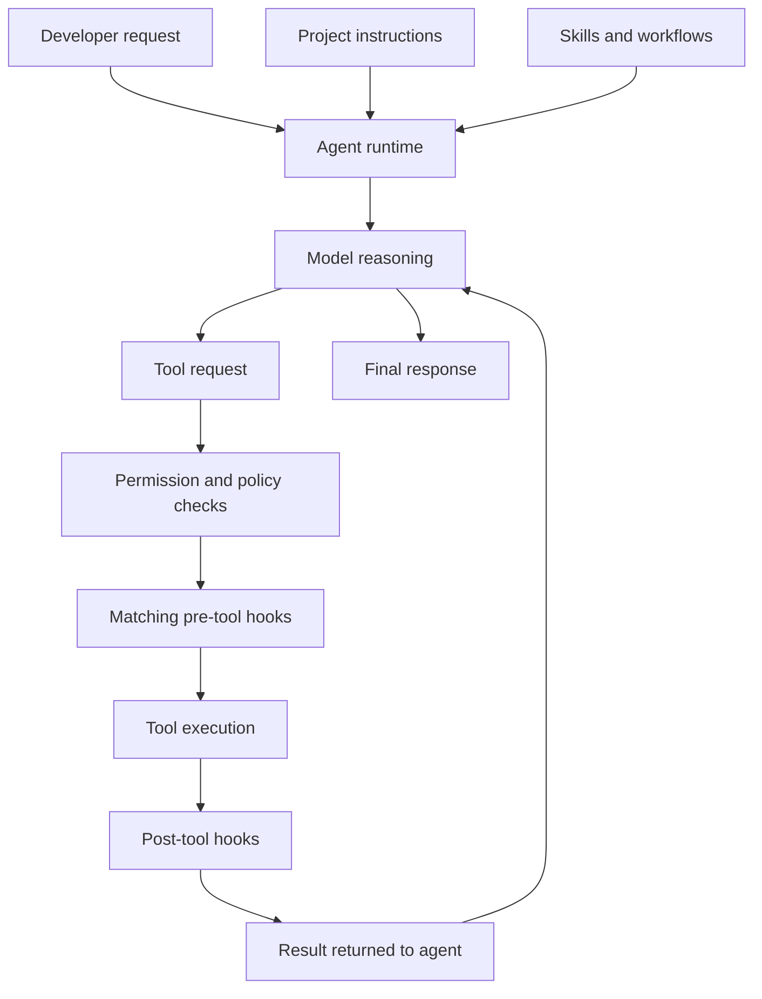
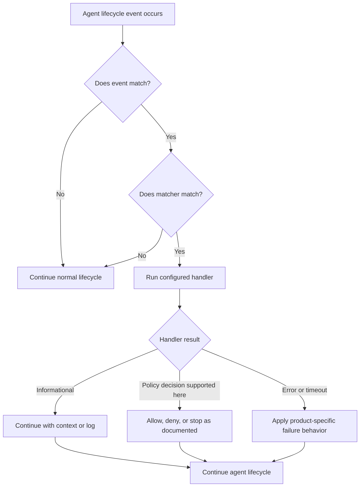
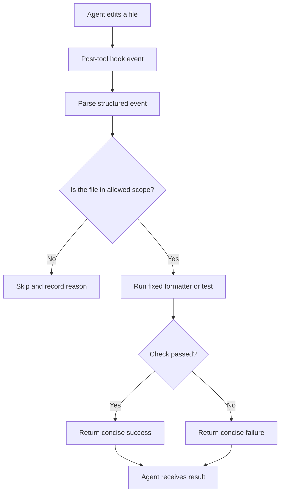
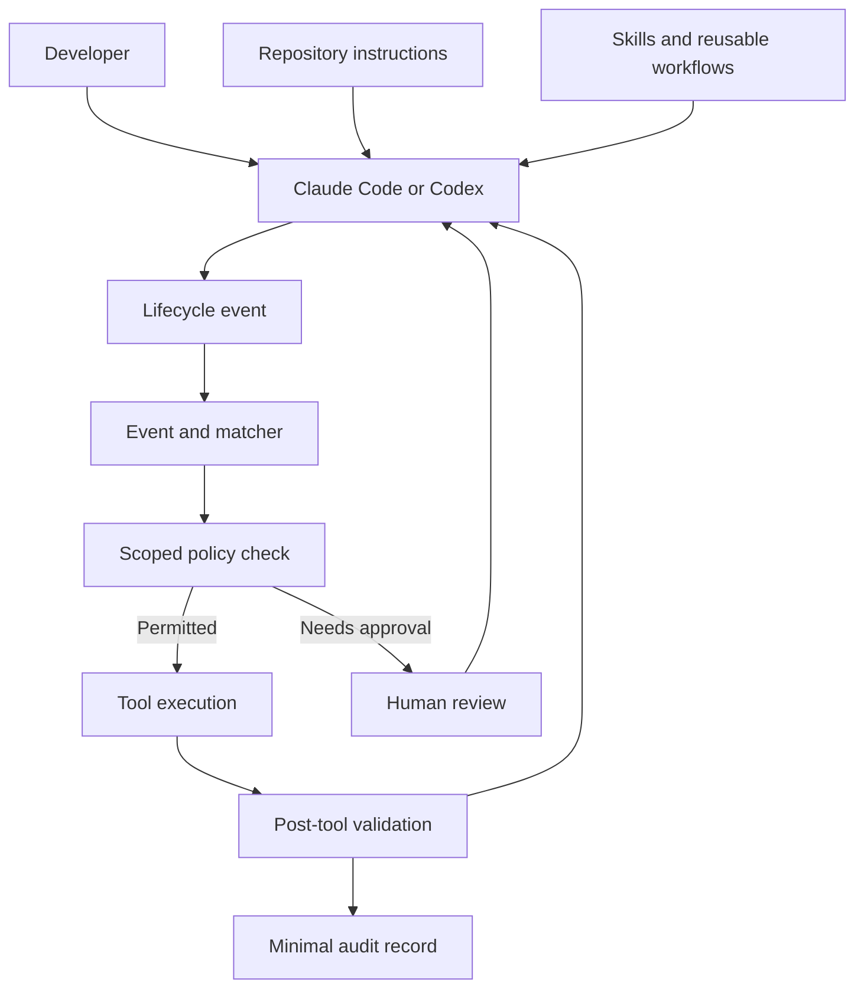

# AI Coding Agent Extensibility — Claude Code and OpenAI Codex

**Specialized practical track · Beginner → Advanced · Updated 7 November 2026**

Learn how modern AI coding agents are configured, extended, automated, and governed. This track focuses on **Claude Code** and **OpenAI Codex**, with hands-on examples, lifecycle diagrams, safe hook implementations, comparison tables, tests, and system-design exercises.

> Core idea: instructions tell an agent what it should do; tools let it do work; hooks let the surrounding runtime run checks or react at defined lifecycle points.

---

## Learning outcomes

By the end, you should be able to:

1. Explain the difference between instructions, rules, skills, hooks, tools, MCP servers, subagents, and plugins.
2. Describe the lifecycle of a Claude Code or Codex session and identify where hooks run.
3. Configure project-level and user-level hooks in both tools.
4. Write a small hook that reads structured input, validates it, and returns a supported result.
5. Use pre-tool and post-tool events for policy checks, formatting, logging, and verification.
6. Design safe boundaries around project-provided hooks and scripts.
7. Compare the two products without assuming their configuration formats or capabilities are interchangeable.
8. Test, debug, version, and evaluate a hook-based workflow.

## 1. First principles: what is a hook?

A hook is a handler that the coding-agent runtime invokes when a named event occurs. Depending on the product and event, the handler may be a command, an MCP tool, an HTTP endpoint, or a model-assisted check.

Examples:

- When a session starts, load concise project context.
- Before a tool runs, apply a deterministic policy check.
- After a file-editing tool runs, run a formatter or targeted test.
- When a turn ends, record a small audit event.
- Before compaction, preserve a short project-state summary.

Hooks are useful when a check should happen because an event occurred—not merely because the model remembered an instruction.

### 1.1 The coding-agent runtime

A coding agent is more than a language model. Its runtime coordinates instructions, context, tools, permissions, execution, and feedback.



This is a conceptual model. Exact ordering and event availability differ by product and release.

### 1.2 Instructions vs hooks

| Mechanism | Main purpose | Is it deterministic? | Example |
|---|---|---:|---|
| Project instructions | Explain project conventions | No; the model interprets them | “Use pytest for Python tests” |
| Rules | Apply scoped instructions | No; model-followed | “For files in `src/api`, follow this API style” |
| Skills | Provide reusable task procedures | Invocation and execution are model-driven | “Use this release checklist” |
| Hooks | React to runtime lifecycle events | Command/tool hooks run when their configured event matches | Run a formatter after an edit |
| Permissions / sandbox | Bound what the agent may access or execute | Enforced by the runtime | Restrict writes or require approval |
| MCP | Connect the agent to external tools and data | Tool behavior depends on server and policy | Query an approved issue tracker |
| Subagents | Delegate bounded work to another agent | Model-orchestrated | Ask a reviewer agent to inspect a patch |
| Plugins | Package and distribute extensions | Depends on plugin components | Bundle skills, tools, and hooks |

**Important:** a hook is not a replacement for permissions or sandboxing. A hook can add a useful check, but the runtime's permission model and operating-system isolation remain important security boundaries.

## 2. Hook lifecycle and event thinking

A hook configuration generally has three parts:

1. **Event:** the lifecycle point, such as `SessionStart`, `PreToolUse`, or `Stop`.
2. **Matcher:** an optional filter, such as a specific tool name.
3. **Handler:** the command, MCP tool, HTTP endpoint, or supported model-assisted handler.



Never assume all events support blocking, all handlers receive the same input, or errors fail closed. Read the event-specific reference for the exact product version.

## 3. Claude Code: the extension surface

Claude Code supports several complementary mechanisms:

- **`CLAUDE.md`** — project or user instructions.
- **Rules** — additional scoped instructions, commonly stored under `.claude/rules/`.
- **Skills** — reusable task knowledge and workflows.
- **Subagents** — specialized agents with their own context and tool constraints.
- **Hooks** — lifecycle-triggered handlers.
- **MCP servers** — external tools and resources.
- **Plugins** — packages that can combine extension components.

### 3.1 Where Claude Code hooks live

Common settings locations:

| File | Scope |
|---|---|
| `~/.claude/settings.json` | User-level settings across projects |
| `.claude/settings.json` | Project-level settings; can be shared with the repository |
| `.claude/settings.local.json` | Local project settings; should not be committed |

Treat project-provided hooks as executable code. Review the scripts and settings before trusting or running them. Do not put credentials, tokens, or private machine paths in committed settings.

### 3.2 Claude Code hook types

The current Claude Code reference describes these handler types:

- **Command:** run a local command or script.
- **HTTP:** send event data to an HTTP endpoint.
- **MCP tool:** invoke a configured MCP tool.
- **Prompt:** ask a model to evaluate the hook input and return a structured decision.
- **Agent:** run an agent-based verifier where supported.

Support varies by event. Command/HTTP/MCP handlers are suitable for deterministic automation; prompt/agent handlers involve model judgment and should not be treated as equivalent to deterministic policy enforcement.

### 3.3 Important Claude Code events

Examples from the lifecycle include:

| Event | When it runs | Typical use |
|---|---|---|
| `SessionStart` | A session starts or resumes | Load lightweight workspace context |
| `UserPromptSubmit` | A prompt is submitted | Validate or classify an incoming request |
| `PreToolUse` | Before a tool call | Apply a tool-specific policy check |
| `PermissionRequest` | A tool needs permission | Add a supported permission decision |
| `PostToolUse` | After a tool call | Format, test, or record a result |
| `PostToolUseFailure` | A tool call fails | Capture diagnostics |
| `Stop` | A turn is stopping | Run a completion check |
| `SubagentStart` / `SubagentStop` | A subagent starts or stops | Track delegated work |
| `PreCompact` / `PostCompact` | Before or after context compaction | Preserve or reload concise state |
| `SessionEnd` | A session ends | Flush a local summary or audit record |

The full reference contains additional events and event-specific constraints. Use the official reference rather than relying on a memorized event list.

### 3.4 A minimal Claude Code configuration

The following is an illustrative project-level configuration. It registers a command hook for a post-tool event. Confirm the event schema and supported fields in the current Claude Code reference before adapting it.

```json
{
  "hooks": {
    "PostToolUse": [
      {
        "matcher": "Write|Edit",
        "hooks": [
          {
            "type": "command",
            "command": "python3 .claude/hooks/check_changed_file.py"
          }
        ]
      }
    ]
  }
}
```

The matcher is intended to scope the handler to file-writing tools. The script should be small, predictable, and limited to the repository's intended files.

A hook command receives event data through standard input as JSON. A minimal diagnostic script can parse the input without making changes:

```python
# .claude/hooks/check_changed_file.py
import json
import sys

def main() -> int:
    try:
        event = json.load(sys.stdin)
    except json.JSONDecodeError:
        print("Hook received invalid JSON input.", file=sys.stderr)
        return 1

    event_name = event.get("hook_event_name", "unknown")
    tool_name = event.get("tool_name", "unknown")

    # Keep logs concise. Do not print secrets or full file contents.
    print(f"Observed {event_name} for tool {tool_name}.")
    return 0

if __name__ == "__main__":
    raise SystemExit(main())
```

This is an observation-only example. It does not block a tool or modify a file. Add behavior only after confirming the event's input schema and supported output/exit-code semantics.

### 3.5 Claude Code: choose the right extension

- Put stable project conventions in `CLAUDE.md` or scoped rules.
- Put repeatable multi-step procedures in skills.
- Use a subagent when work benefits from a separate context or specialized role.
- Use a hook when an event should trigger an automatic action or check.
- Use permissions and sandbox controls to enforce access boundaries.
- Use MCP when the agent needs a structured connection to an external system.

Official overview: [Steering Claude Code: skills, hooks, rules, subagents, and more](https://claude.com/resources/articles/steering-claude-code-skills-hooks-rules-subagents-and-more).

## 4. OpenAI Codex: the extension surface

Codex also has multiple layers:

- **`AGENTS.md`** — repository and directory-level agent instructions.
- **Skills** — reusable workflows and domain-specific procedures.
- **Hooks** — lifecycle-triggered scripts or MCP tool calls.
- **MCP servers** — external tools and data sources.
- **Plugins** — packaged extensions where supported.
- **Configuration and approval controls** — govern execution, access, and trust.

Do not assume Claude Code's settings files, event names, or handler formats work in Codex.

### 4.1 Where Codex hooks live

The current Codex hooks documentation describes hook configuration through `hooks.json` or inline `[hooks]` tables in `config.toml`. Common locations include:

| File | Scope |
|---|---|
| `~/.codex/hooks.json` | User-level hooks |
| `~/.codex/config.toml` | User-level configuration and hooks |
| `.codex/hooks.json` | Project-level hooks |
| `.codex/config.toml` | Project-level configuration and hooks |

Project-local configuration is subject to project trust. Codex requires review/trust for non-managed hooks before they run. Use the CLI's `/hooks` interface to inspect and review hook definitions.

### 4.2 Codex hook events

Examples documented for Codex include:

| Event | Typical use |
|---|---|
| `SessionStart` | Load workspace context at session start or resume |
| `UserPromptSubmit` | Inspect or annotate a submitted prompt |
| `PreToolUse` | Apply a pre-execution check |
| `PermissionRequest` | Add a permission-related check |
| `PostToolUse` | Inspect tool results or run a follow-up check |
| `PreCompact` / `PostCompact` | Preserve or restore concise session context |
| `SubagentStart` / `SubagentStop` | Observe delegated work |
| `Stop` | Perform a turn-end check |
| `Interrupt` | Respond to an interrupted turn |
| `SessionEnd` | Run session cleanup or record a summary |
| `PreModelRequest` / `PostModelRequest` | Observe model-request boundaries |

The event list and behavior are product-version specific. Check the current reference for exact fields and support.

### 4.3 Codex handler types and trust

The current Codex hooks reference documents command and MCP-tool handlers. It also notes that prompt and agent handler types may be parsed but are not executed as supported Codex hook handlers in the documented configuration. Do not copy Claude Code prompt/agent hook configurations into Codex.

Important trust behavior:

1. Codex discovers hooks from active configuration layers.
2. It presents non-managed hook definitions for review.
3. A hook must be trusted before it can run.
4. If the hook definition changes, its trust state may need to be reviewed again.
5. Project hooks are only loaded when the project configuration layer is trusted.

This review step matters because a hook command can execute code on the developer's machine.

### 4.4 A minimal Codex configuration

Illustrative `.codex/hooks.json`:

```json
{
  "description": "Small project-local lifecycle example",
  "hooks": {
    "SessionStart": [
      {
        "matcher": "startup|resume",
        "hooks": [
          {
            "type": "command",
            "command": "python3 .codex/hooks/session_start.py",
            "statusMessage": "Checking workspace context",
            "timeout": 10
          }
        ]
      }
    ]
  }
}
```

Codex command hooks receive a JSON object on standard input. A minimal script can inspect the event and print a short informational message:

```python
# .codex/hooks/session_start.py
import json
import sys

def main() -> int:
    try:
        event = json.load(sys.stdin)
    except json.JSONDecodeError:
        print("Could not parse hook input.", file=sys.stderr)
        return 1

    source = event.get("source", "unknown")
    cwd = event.get("cwd", "unknown")

    # Avoid logging secrets or dumping the full event payload.
    print(f"Session source: {source}")
    print(f"Workspace: {cwd}")
    return 0

if __name__ == "__main__":
    raise SystemExit(main())
```

This is an informational example, not an authorization system. For policy enforcement, follow the exact event-specific output contract. In particular, Codex documents that some events do not support the same stop/continue fields as others.

## 5. Claude Code vs Codex: compare the concepts, not just the syntax

| Area | Claude Code | OpenAI Codex |
|---|---|---|
| Main instruction file | `CLAUDE.md` | `AGENTS.md` |
| Hook configuration | JSON settings files and supported frontmatter locations | `hooks.json` or `config.toml` |
| Hook handlers | Command, HTTP, MCP tool, prompt, agent — support varies by event | Command and MCP tool in the current documented hook reference |
| Hook input | Structured event data; command input is provided on stdin | Structured JSON input on stdin for command hooks |
| Project trust | Review project settings and executable scripts carefully; scope settings deliberately | Explicit review/trust flow for non-managed hooks |
| Reusable workflows | Skills | Skills |
| Delegation | Subagents | Subagents |
| External tools | MCP | MCP |
| Security controls | Permissions, sandboxing, hook decisions, settings policy | Approval modes, sandboxing, hook trust, managed configuration |

**Design lesson:** learn the event model and security boundary first. Then learn each product's configuration syntax separately.

## 6. Build a safe, useful hook workflow

A good first project is a **post-edit quality check**. The goal is to make the workflow repeatable without granting the hook broad access.

### 6.1 Requirements

- Run only after relevant file-editing events.
- Read the event payload from standard input.
- Identify the changed file using documented event fields.
- Allow only files inside the repository's intended source directory.
- Run a formatter or targeted test using a fixed command.
- Keep output short and avoid printing source contents or secrets.
- Set a timeout and handle failures clearly.
- Do not silently treat a failed check as a successful validation.

### 6.2 Architecture



### 6.3 Security design checklist

- **Least privilege:** the hook should only read or write what it needs.
- **Fixed commands:** avoid constructing shell commands from untrusted event strings.
- **Path validation:** resolve paths and confirm they remain under the repository root.
- **No secret logging:** never dump full environment variables, credentials, or full transcripts.
- **Timeouts:** prevent a hook from hanging an agent session indefinitely.
- **Explicit trust:** inspect project hooks before enabling them.
- **Version control:** review hook changes like application code.
- **Failure semantics:** decide whether a failure is informational, blocks an action, or stops a workflow—only where the product supports that behavior.
- **Human review:** keep approval for consequential operations; a hook is not a substitute for a sound permission model.

### 6.4 Common mistakes

1. Putting every instruction into a hook instead of using the right extension mechanism.
2. Assuming a post-tool hook can retroactively prevent a tool call.
3. Assuming every hook event supports blocking.
4. Copying a Claude Code event name or JSON schema into Codex.
5. Running project hooks without inspecting their scripts.
6. Logging complete prompts, transcripts, or tool payloads unnecessarily.
7. Creating hooks that run on every event when a narrower matcher would work.
8. Treating a successful hook as proof that the entire code change is correct.

## 7. Testing and debugging hooks

Test hooks like ordinary software.

### Unit tests

- Valid JSON input.
- Missing optional fields.
- Unknown event names.
- Unexpected tool names.
- Paths outside the intended repository directory.
- Malformed input.
- Formatter or test command failure.
- Timeout behavior.

### Integration tests

- Confirm the hook fires for the intended event.
- Confirm it does not fire for unrelated tools.
- Confirm the runtime receives the expected output.
- Verify the actual allow/deny/stop behavior only for events that document that capability.
- Test both a trusted project and an untrusted project where applicable.
- Test after changing the hook definition and reviewing trust again.

### Observability

Record only what is necessary:

- event name
- hook identifier/version
- start and end timestamps
- duration
- result category
- concise failure reason

Avoid storing raw prompts, full transcripts, secrets, or sensitive file contents unless there is a clear, approved need and retention policy.

## 8. Hands-on learning sequence

| Lesson | Focus | Deliverable |
|---|---|---|
| 1 | Agent runtime and lifecycle fundamentals | Draw the lifecycle diagram |
| 2 | Instructions, rules, skills, tools, MCP, subagents, plugins | Choose the right extension for 8 scenarios |
| 3 | Claude Code hooks | Configure and test an observation-only hook |
| 4 | Codex hooks | Configure and test a session-start hook |
| 5 | Event matching and structured input/output | Write a parser with unit tests |
| 6 | Pre-tool policy and post-tool verification | Build a safe, scoped quality-check workflow |
| 7 | Trust, permissions, sandboxing, and threat modeling | Write a hook security review |
| 8 | Cross-tool comparison | Port the design concept—not copied config—between tools |
| 9 | Production design and evaluation | Present a hook-based coding-agent architecture |

### Exercise 1 — Pick the right mechanism

For each requirement, choose instructions, a skill, a hook, a permission rule, MCP, or a subagent. Explain why.

1. Always use the repository's Python version and formatting conventions.
2. Run a fixed formatter after a supported file-edit event.
3. Provide a repeatable procedure for preparing a release.
4. Let the agent query an approved internal documentation service.
5. Require approval before a consequential operation.
6. Ask a separate reviewer to inspect a patch without filling the main agent context with every intermediate note.

### Exercise 2 — Hook event reasoning

For each action, decide whether a pre-tool event, post-tool event, session event, or turn event is the best fit:

1. Inspect a tool request before execution.
2. Run tests after a file edit.
3. Load a short project status when a session begins.
4. Save a concise completion record when a turn ends.

Then explain which actions are merely observational and which require a documented decision capability.

### Exercise 3 — Cross-platform implementation

Implement the same conceptual workflow in both tools:

- On session start, print a concise workspace identifier.
- After a relevant file edit, run a small local validation.
- Do not access files outside the repository.
- Keep logs free of secrets.
- Document how a developer reviews and trusts the hook.

Submit separate Claude Code and Codex configurations. Do not reuse one product's configuration file for the other.

## 9. Interview questions with answer guidance

**Q1. What is a hook in an AI coding agent?**  
A lifecycle-triggered handler that lets the runtime run a configured check or action when a defined event occurs.

**Q2. How is a hook different from an instruction file?**  
An instruction file guides model behavior. A hook is invoked by the runtime when its event and matcher conditions are met. For a requirement that must happen at a specific lifecycle point, a hook can provide stronger repeatability.

**Q3. Why are pre-tool and post-tool hooks different?**  
A pre-tool hook runs before the operation and may support a policy decision for that event. A post-tool hook runs after the operation and is useful for validation, formatting, or recording results. A post-tool check cannot undo an already completed action.

**Q4. Are hooks a security boundary?**  
Not by themselves. They are one layer. Permissions, sandboxing, trust review, least privilege, and operating-system controls remain essential.

**Q5. Why should Claude Code and Codex hooks be implemented separately?**  
They have different configuration formats, event schemas, supported handler types, and trust/decision semantics. A shared design can be ported, but configuration should be written and tested for each runtime.

**Q6. What should happen if a hook fails?**  
The behavior must be chosen according to the event's documented contract and the risk of the operation. Do not assume all failures block execution or that all events support a stop decision.

**Q7. How do you prevent a project hook from becoming a supply-chain risk?**  
Review the configuration and referenced scripts, use trusted sources, constrain permissions and paths, avoid secrets, pin dependencies where appropriate, and re-review changes.

## 10. System-design exercise: a governed AI coding workspace

Design a team coding environment where Claude Code and Codex can work on a shared repository while preserving consistent quality and review.

### Functional requirements

- Load repository conventions at session start.
- Give developers reusable workflows for common tasks.
- Run scoped checks after relevant edits.
- Apply pre-execution policy checks where supported.
- Preserve concise audit metadata.
- Require human approval for consequential actions.

### Non-functional requirements

- Low latency and low context overhead.
- Reproducible behavior.
- Minimal access to local files and credentials.
- Clear failure semantics.
- Auditable configuration changes.
- Portable design across coding-agent runtimes.

### Architecture prompt



Discuss where the two products need separate adapters, what belongs in shared scripts, how hook trust is managed, how failures are surfaced, and which operations must remain under explicit human approval.

## 11. Suggested repository project structure

A learning implementation can use this structure. Keep the examples harmless and observation-first until the event contract and trust model are understood.

```text
ai-coding-agent-hooks/
├── README.md
├── shared/
│   ├── event_parser.py
│   ├── path_policy.py
│   └── tests/
├── claude-code/
│   ├── settings.example.json
│   └── hooks/
│       └── observe_event.py
└── codex/
    ├── hooks.example.json
    └── hooks/
        └── observe_event.py
```

The shared code can contain portable validation logic. The product-specific folders should contain separate configuration and adapters for each runtime.

## 12. Primary documentation

Use official documentation as the source of truth because hook events, fields, and supported handler types can change.

- [Claude Code — Hooks reference](https://code.claude.com/docs/en/hooks)
- [Claude Code — Automate actions with hooks](https://code.claude.com/docs/en/hooks-guide)
- [Anthropic — Steering Claude Code: skills, hooks, rules, and subagents](https://claude.com/resources/articles/steering-claude-code-skills-hooks-rules-subagents-and-more)
- [OpenAI Codex — Hooks](https://learn.chatgpt.com/docs/hooks)
- [OpenAI Codex — Configuration reference in the Codex repository](https://learn.chatgpt.com/docs/config-file/config-advanced)
- [OpenAI Codex — AGENTS.md guidance](https://developers.openai.com/codex/guides/agents-md)

### Versioning note

This guide reflects the official references reviewed on **7 November 2026**. Treat event lists and configuration examples as version-sensitive. Before deploying a hook, verify its current event schema, supported handler type, output contract, trust behavior, and failure semantics in the official documentation.

---

## Completion checklist

- [ ] I can explain the agent lifecycle without relying on product-specific terminology.
- [ ] I can distinguish instructions, skills, hooks, tools, MCP, subagents, and permissions.
- [ ] I can explain the Claude Code hook configuration structure.
- [ ] I can explain the Codex hook configuration and trust-review flow.
- [ ] I have written and tested an observation-only hook for each product.
- [ ] I understand pre-tool vs post-tool timing and limitations.
- [ ] I can threat-model a project-provided hook.
- [ ] I can design a shared workflow with separate product-specific adapters.
- [ ] I can explain the architecture and trade-offs in a system-design interview.
