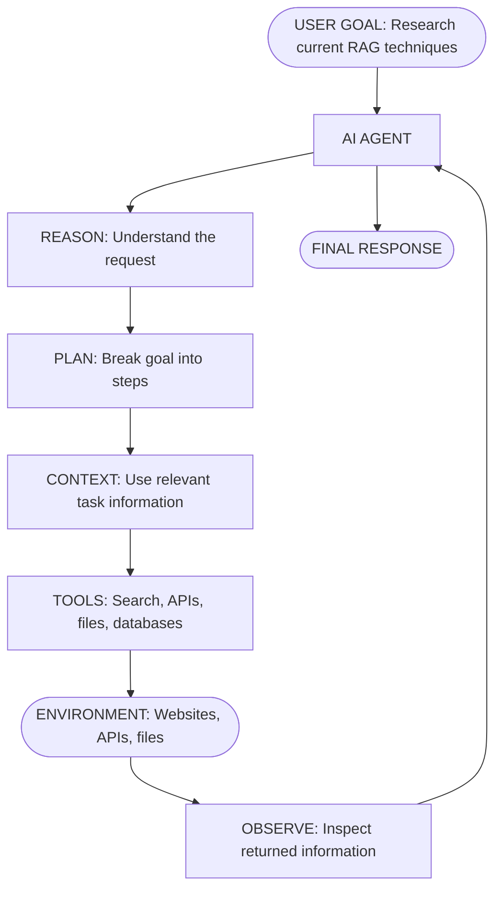
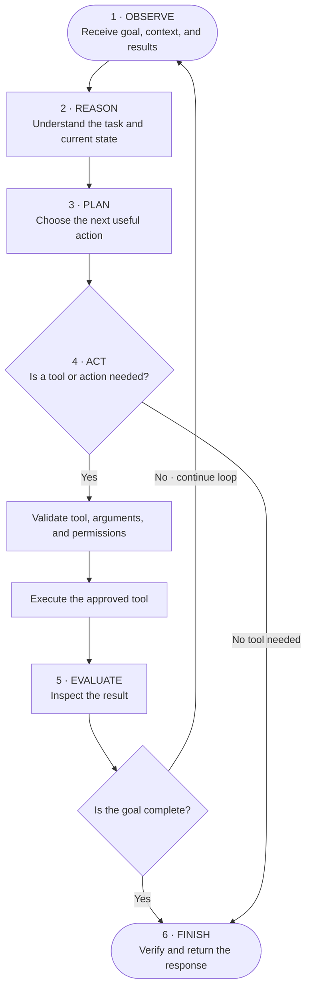
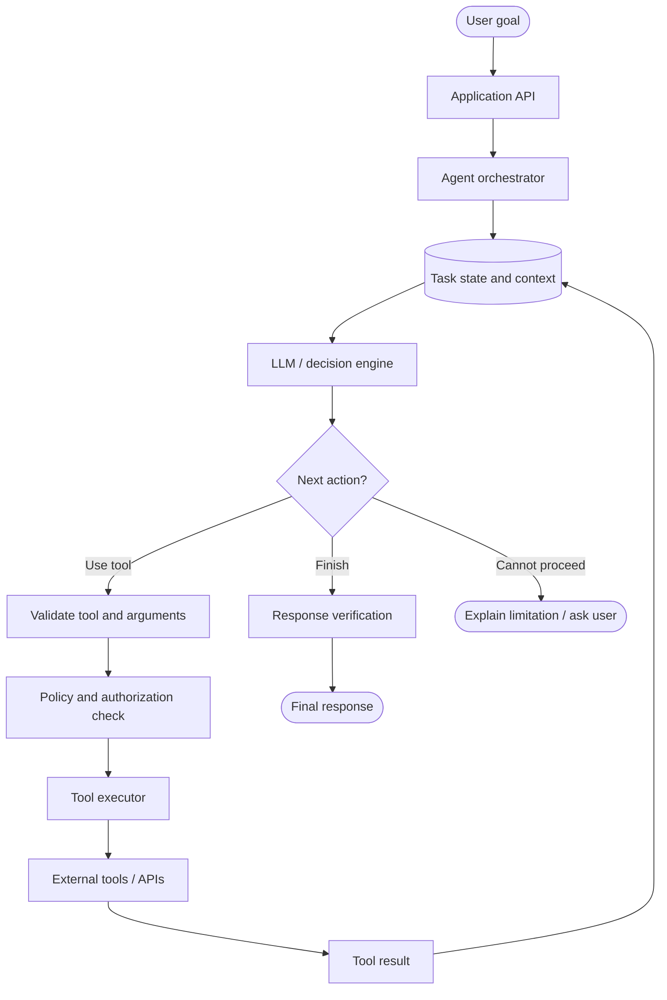
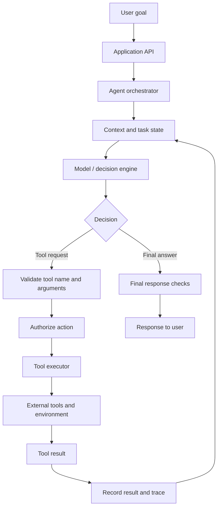
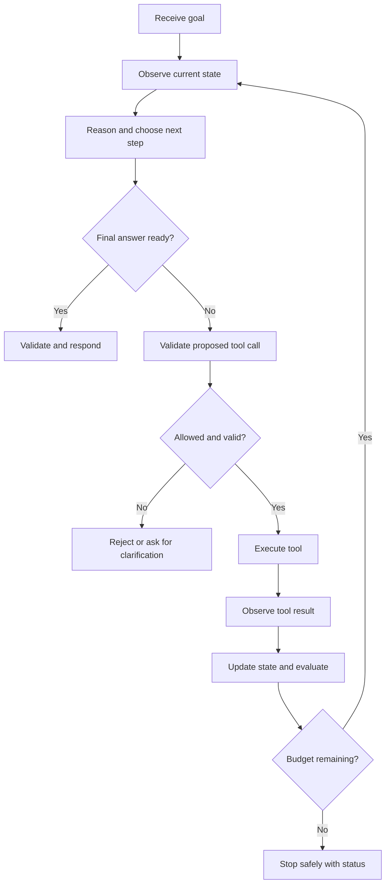
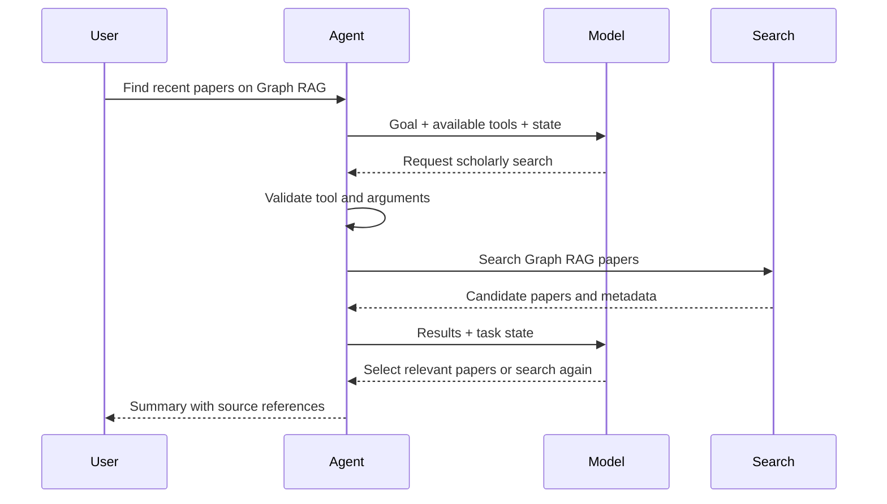
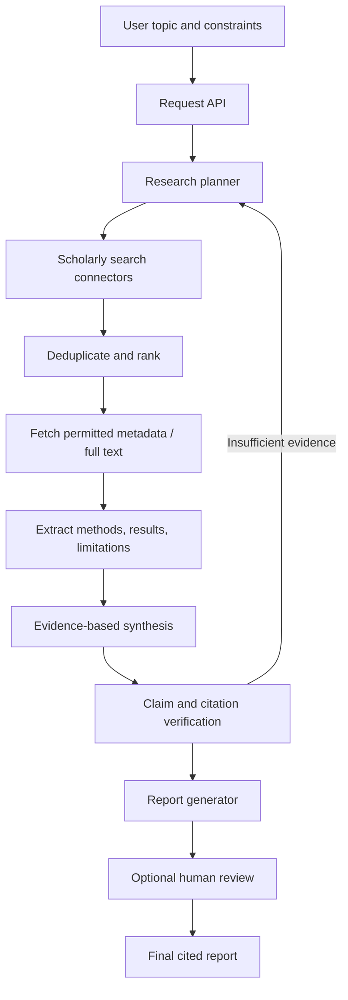

# Module 1 — Foundations of Agentic AI

**Curriculum:** v1  
**Level:** Beginner → Intermediate  
**Goal:** Understand what makes a system agentic, explain its architecture, implement a bounded tool-using agent, and defend design decisions in an interview.

> Learning principle: understand the mechanics with plain Python before adding an LLM framework.

## Day 1 — Topic 1: What Is an AI Agent?

**Beginner → Intermediate**

By the end of this topic, you should be able to:

1. Define an AI agent from first principles.
2. Explain how an agent differs from a traditional AI model and chatbot.
3. Understand and draw the basic architecture of an agent.
4. Explain how an agent observes, reasons, acts, and evaluates results.
5. Build a minimal agent in Python.
6. Answer foundational agent-design interview questions.

### 1. The problem agents solve

Imagine asking an AI system:

> Find three research papers about RAG, compare their approaches, and prepare a summary with references.

A language model can generate text, but it may not know the latest papers or have the ability to search the web, retrieve documents, compare their contents, or save a report.

An agentic system can coordinate those steps:

1. Understand the goal and constraints.
2. Break the goal into smaller tasks.
3. Search for relevant papers.
4. Retrieve and inspect the papers.
5. Extract useful information.
6. Compare methods and limitations.
7. Prepare a report with references.
8. Check whether the result satisfies the request.

**The key distinction:** the system is not only generating text; it is selecting and carrying out actions to make progress toward a goal.

### 2. What is an AI agent?

An AI agent is a system that receives a goal, observes relevant information, chooses actions, uses tools or interfaces to carry out those actions, and uses the resulting feedback to decide what to do next.

A compact definition:

> An AI agent is a goal-directed system that uses a decision-making mechanism, context, and available actions or tools to interact with an environment and make progress toward a task.

An agent does not have to use an LLM. It can use rules, a learned policy, an LLM, or a combination. What makes it agentic is the action-and-feedback process—not simply the presence of a language model.

### 3. Basic agent architecture — understand the big picture first

Start with this simplified view before learning the detailed production architecture:



Think of the agent as the coordinator. It receives a goal, decides what should happen, asks the tool layer to perform an approved action, and then uses the result to decide the next step.

The environment is the outside world the agent interacts with—for example, websites, APIs, files, databases, or business applications.

This is a conceptual overview. In a real implementation, the model, planner, memory, and orchestrator may be separate services or combined into fewer components.

### 4. The five foundational components

| Component | Responsibility | Example in a research assistant |
|---|---|---|
| **Agent / orchestrator** | Coordinates the task and controls execution | Manages the research process |
| **Model / decision engine** | Interprets context and proposes a response or action | Chooses whether to search or summarize |
| **Tools** | Provide controlled access to external capabilities | Scholarly search, file reader, database |
| **Memory / state** | Keeps relevant context and task progress | Stores papers already reviewed |
| **Planner** | Chooses or organizes the steps needed | Search → retrieve → compare → report |

**Model vs agent:** a model produces an output. An agent is the larger system that uses a decision mechanism, state, tools, and an execution loop to act toward a goal.

#### Tools: how the agent acts

| Tool | Purpose |
|---|---|
| Web or scholarly search | Find current information |
| Python | Run calculations or data processing |
| Database API | Retrieve stored records |
| File reader | Read documents |
| Calculator | Perform arithmetic |
| Email or business API | Perform an approved external operation |

The model may propose a tool call, but trusted application code must validate the tool name, arguments, permissions, and execution limits before running it. Never execute arbitrary model-generated text as code.

#### Memory and state are related, but different

- **State** is the information needed to continue the current task: current step, results, status, and retry count.
- **Short-term memory** is recent conversation or task context.
- **Long-term memory** is information deliberately persisted across tasks, subject to privacy and retention controls.

Memory is not necessarily permanent. Store only what is needed for a clear purpose.

### 5. Agent execution loop — the most important concept

A common agent loop is:



The loop in plain language:

1. **Observe:** receive the user's request and relevant environment information.
2. **Reason:** interpret the task and understand the current state.
3. **Plan:** choose the next action or steps.
4. **Act:** call an approved tool or take another permitted action.
5. **Evaluate:** inspect the result and decide whether it is useful and sufficient.
6. **Repeat or finish:** continue if more work is needed; otherwise verify and respond.

#### Walkthrough: find recent Graph RAG papers

| Stage | What the agent does |
|---|---|
| Observe | Receives the request for recent Graph RAG papers |
| Reason | Recognizes that current research sources are needed |
| Plan | Decides to search, filter, retrieve, and compare papers |
| Act | Calls an approved scholarly-search tool |
| Evaluate | Checks relevance, dates, and whether enough useful papers were found |
| Repeat | Refines the search if the results are insufficient |
| Finish | Produces a summary with source references |

The next action depends on the previous result. If search results are poor, the agent may refine the query. If the results are sufficient, it can move to comparison. This feedback-driven adaptation is central to agentic behavior.

### 6. Basic agent architecture vs execution loop

These two diagrams answer different questions:

- **Architecture:** What components make up the system, and how do they connect?
- **Execution loop:** In what order does the system observe, decide, act, and use feedback?

Keep both diagrams in mind. In a system-design interview, you should be able to draw the component architecture and then trace one request through its execution loop.


## Architecture diagram



> This is a conceptual reference architecture. Adapt the components and control flow to the system requirements.

---

## Learning outcomes

By the end of this module, you should be able to:
1. Define an AI agent and distinguish a model, chatbot, workflow, and agent.
2. Explain the roles of the model, tools, memory, state, planner, orchestrator, and environment.
3. Trace the observe → reason → plan → act → evaluate loop.
4. Choose appropriate stopping conditions and control execution budgets.
5. Design basic failure handling, tool validation, and permission boundaries.
6. Implement and test a small tool-using agent in Python.
7. Draw a system architecture and answer module-level interview questions.

## Topic map

| Topic | Core question | Deliverable |
|---|---|---|
| 1. What is an AI agent? | What makes a system act toward a goal? | Agent concept map |
| 2. Model vs chatbot vs agent | Where does the model end and the system begin? | Comparison table |
| 3. What makes a system agentic? | How much autonomy and feedback does it have? | Agenticness analysis |
| 4. Agents, tools, memory, planning | What are the main building blocks? | Component diagram |
| 5. Agent execution loop | How does the system select and execute its next action? | Sequence diagram |
| 6. Stopping and failure handling | How does it stop safely and recover? | Bounded Python implementation |

---

# 1. What is an AI agent?

An AI agent is a system that receives a goal or task, observes relevant information, selects actions, and uses feedback from the environment to make progress toward the goal.

An agent is not defined simply by using a large language model. It is defined by the surrounding system's ability to select and execute actions in a feedback loop.

### Example: research assistant

**Goal:** Find relevant papers about Graph RAG, compare their methods, and prepare a sourced summary.

A possible sequence:
1. Interpret the request and identify constraints.
2. Plan a search strategy.
3. Call a scholarly search tool.
4. Inspect the returned paper metadata and sources.
5. Decide whether more searches are needed.
6. Retrieve and analyze relevant papers.
7. Check whether claims have supporting sources.
8. Produce the report or explain what could not be verified.

The agent's next step depends on the previous tool results. That feedback-driven behavior is central to agentic systems.

### Agent, model, chatbot, workflow

| System | What it does | Example |
|---|---|---|
| AI model | Maps input to output | A language model generates a summary |
| Chatbot | Provides a conversational interface | A bot answers questions in a chat window |
| Workflow | Executes a predefined sequence | Parse file → summarize → save |
| AI agent | Selects actions based on goal and observations | Searches, evaluates results, and decides whether to search again |

These categories can overlap. A chatbot can contain an agent; an agent can use a fixed workflow for some subtasks. Not every workflow needs an agent.

### When is an agent useful?

Use an agent when:
- The task has multiple steps.
- The next action depends on intermediate results.
- The system needs to choose among tools or strategies.
- The environment can change or return uncertain results.
- A goal is better specified than a fixed sequence of steps.

Prefer a simple deterministic program or workflow when:
- The steps are known in advance.
- The task is short and predictable.
- Autonomy adds more risk or complexity than value.
- The system must behave identically and be easy to audit.

**Key trade-off:** More autonomy can improve flexibility, but it also introduces more latency, cost, uncertainty, and failure modes.

---

# 2. AI model vs chatbot vs AI agent

## AI model

A model is a learned function that processes inputs and produces outputs. A language model may generate text, classify content, extract structured information, or propose a tool call.

A model does not automatically have permission or ability to perform external actions. Those capabilities are supplied by the application around it.

## Chatbot

A chatbot is an application that lets a user communicate through a conversational interface. It may use a model and may or may not have tools, memory, or agentic behavior.

## AI agent

An agent is a system that can select actions and use the results to decide what happens next. It often includes:
- A model or decision policy
- An instruction and context builder
- A planner or action-selection mechanism
- A tool registry and tool executor
- State and memory
- An execution loop and stopping rules
- Logging, evaluation, and safety controls

### Comparison

| Capability | Model alone | Basic chatbot | Tool-using agent |
|---|---:|---:|---:|
| Generate text | Yes | Yes | Yes |
| Maintain conversation context | Not inherently | Usually | Usually |
| Call external tools | Not by itself | Optional | Common |
| Select next action from results | Not by itself | Optional | Core capability |
| Execute multi-step tasks | Not by itself | Limited/optional | Common |
| Needs stopping and budget controls | N/A | Sometimes | Yes |

**Interview point:** Do not say that every LLM is an agent. Explain the additional control loop, tools, state, and environment interaction.

---

# 3. What makes a system agentic?

Agentic behavior is a spectrum, not a binary label.

A useful analysis considers:

1. **Goal-directedness:** Does the system work toward an explicit objective?
2. **Action selection:** Does it choose among possible actions?
3. **Tool use:** Can it affect or query external systems?
4. **Feedback:** Does it observe action results?
5. **Adaptation:** Can the next action change based on those results?
6. **Multi-step execution:** Can it coordinate a sequence of actions?
7. **Bounded autonomy:** Are its permissions, budgets, and stopping conditions defined?

### Example spectrum

- Level 0: A model answers a one-shot question.
- Level 1: A chatbot uses conversation context.
- Level 2: A system calls one tool selected by a model.
- Level 3: A system uses tool results to choose subsequent actions.
- Level 4: A system plans and executes a bounded multi-step task with state, evaluation, and recovery.

This is a teaching model, not a universal industry classification.

### Important distinction: autonomy is not unlimited permission

A useful production agent should have:
- An explicit goal and scope
- An allowlist of tools
- Typed and validated tool inputs
- Per-action authorization
- Maximum steps and time budgets
- Human approval for consequential operations
- Audit logs and a way to stop execution

---

# 4. Core components of an agent

## 4.1 Model / decision engine

Interprets input and helps choose a response or action. It may be an LLM, a smaller classifier, a rules engine, or a combination.

## 4.2 Tools

Tools are controlled interfaces to external capabilities: search, calculator, database query, document retrieval, or a business API.

A good tool has:
- A clear name and description
- A narrow responsibility
- A typed input schema
- A predictable output format
- Timeouts and error behavior
- Authorization and audit logging where needed

The model should request a tool call; trusted application code validates and executes it. Never treat arbitrary model-generated text as executable code.

## 4.3 Planner

The planner decides what steps may be needed to reach the goal. Planning may be explicit (a task list) or implicit (selecting one next action at a time).

A plan should be revisable when new information arrives.

## 4.4 Orchestrator / executor

The orchestrator controls the lifecycle:
- Builds model context
- Requests a decision
- Validates the requested action
- Executes approved tools
- Stores the result
- Checks budgets and stopping conditions
- Returns the final response

The model proposes; the orchestrator enforces.

## 4.5 State and memory

These terms are related but not identical.

- **State:** Information required to continue the current task, such as current step, tool results, status, and retry count.
- **Short-term memory:** Recent conversation or task context.
- **Long-term memory:** Information deliberately persisted across tasks, subject to privacy and retention rules.

Do not store everything by default. Store only information needed for a defined purpose, with access controls and retention limits.

## 4.6 Environment

The environment is everything the agent observes or interacts with: APIs, files, databases, websites, devices, or a simulated world.

## 4.7 Evaluator / verifier

Checks whether an action or final result meets requirements. Verification can include schema validation, source checks, unit tests, business rules, or human review.

---

# 5. Reference architecture

The diagram shows a common tool-using agent. A real product may combine or omit components.



### Component responsibilities

| Component | Responsibility | Important design question |
|---|---|---|
| Application API | Authentication and request intake | Who is the caller? |
| Orchestrator | Controls the agent loop | What happens next? |
| Context/state store | Tracks task state | What must survive a restart? |
| Model | Proposes response or action | Is the decision valid and useful? |
| Validator | Checks schema and tool allowlist | Is this a permitted request? |
| Authorization layer | Checks caller permissions | May this user perform this action? |
| Tool executor | Runs the approved tool | How are timeout and retries handled? |
| Environment | Supplies data or performs operations | Is the result trustworthy and current? |
| Evaluator | Checks completion and quality | Is the goal actually satisfied? |
| Observability | Records events and metrics | Can we debug failures? |

### Trust boundary

Treat user input, retrieved documents, web pages, and tool outputs as untrusted data. They may contain misleading instructions. Tool permissions must be enforced by trusted application code, not by instructions in retrieved content.

---

# 6. Agent execution loop

A useful conceptual loop is:

1. **Observe:** collect user request, current state, and environment feedback.
2. **Reason:** interpret the task and the available evidence.
3. **Plan:** identify a next action or a sequence of steps.
4. **Act:** request and execute an allowed action.
5. **Evaluate:** inspect the result and decide whether the goal is complete.
6. **Repeat or stop:** continue within the defined execution budget.



### Sequence example



### ReAct connection

ReAct is a research pattern that interleaves reasoning and acting. For practical implementations, keep the focus on observable decisions, tool calls, results, and verification rather than exposing or depending on private internal reasoning traces.

---

# 7. Stopping conditions and failure handling

An agent must have a clear definition of when to stop. Otherwise, it can loop, waste resources, or repeat actions.

## Stopping conditions

- Goal completion is verified.
- Maximum number of steps is reached.
- Time or token budget is exhausted.
- A required tool is unavailable.
- The agent needs clarification or human approval.
- A safety or authorization check rejects the action.
- Repeated failures exceed the retry policy.

## Failure modes and mitigations

| Failure | Example | Mitigation |
|---|---|---|
| Tool timeout | Search API does not respond | Timeout, bounded retry, fallback |
| Invalid arguments | Missing required search query | Schema validation; ask model to repair within limits |
| Unknown tool | Model requests a tool not registered | Reject using an allowlist |
| Repeated action | Same search repeated endlessly | Detect duplicates; cap steps |
| Empty result | No papers found | Reformulate once or report no evidence |
| Incorrect result | Tool returns malformed data | Validate response schema |
| Partial completion | Some subtasks fail | Report completed and incomplete parts |
| Unauthorized action | Tool request exceeds user permission | Enforce authorization outside the model |
| Prompt injection | Retrieved text tells agent to ignore rules | Treat retrieved content as untrusted data |

### Retry design

Retry only when the failure is plausibly transient. Use a small maximum retry count and backoff. Do not blindly retry non-idempotent actions such as sending a payment or creating an order. For consequential operations, use idempotency keys and explicit approval.

### Useful operational metrics

- Task success rate
- Tool-call success and failure rates
- Invalid tool-call rate
- Average and percentile task latency
- Average steps per task
- Cost per successful task
- Retry rate
- Human handoff rate
- Citation or evidence correctness where applicable

---

# 8. Practical implementation

The companion implementation is in [implementations/module-1-foundations/](../implementations/module-1-foundations/).

It demonstrates:
- A small tool registry
- A deterministic planner
- Validated tool arguments
- A bounded execution loop
- State and event history
- Unknown-tool rejection
- A maximum-step stopping condition
- Unit tests

The first implementation intentionally uses a deterministic planner. This makes the execution mechanics easy to inspect. A later extension can replace the planner with an LLM that emits structured tool requests; the validation, authorization, executor, and budget controls should remain in trusted code.

## Run it

From the repository root:

```bash
python -m unittest discover -s implementations/module-1-foundations -p "test_*.py" -v
python implementations/module-1-foundations/agent.py
```

No third-party packages are required.

---

# 9. System design exercise — research assistant

**Prompt:** Design an agent that accepts a research topic, searches scholarly sources, retrieves paper metadata, compares findings, and prepares a cited report.

## Requirements to clarify

- Which scholarly sources are allowed?
- How many papers should be reviewed?
- What date range and publication types are relevant?
- Should the system retrieve full text or only abstracts and metadata?
- What citation format is required?
- What is the latency and cost target?
- Should a human review the report before publication?

## Functional requirements

1. Accept a topic and constraints.
2. Search approved scholarly sources.
3. Deduplicate and rank candidate papers.
4. Retrieve permitted metadata or full text.
5. Extract methods, results, and limitations.
6. Compare evidence across papers.
7. Attach traceable citations.
8. Report uncertainty and incomplete retrieval.

## Non-functional requirements

- Source traceability
- Permission-aware access
- Bounded runtime and cost
- Recoverability after transient failures
- Reproducible logs
- No unsupported claims presented as verified findings

## High-level architecture



## Data model sketch

**ResearchTask**
- task_id
- user_id
- topic
- constraints
- status
- created_at
- step_count
- budget_remaining

**Paper**
- paper_id
- title
- authors
- publication_date
- source
- abstract
- canonical_url
- retrieval_status

**Evidence**
- evidence_id
- paper_id
- claim
- supporting_excerpt_or_location
- confidence_or_review_status

**AgentEvent**
- event_id
- task_id
- step
- event_type
- tool_name
- status
- duration_ms
- error_code

## API sketch

- `POST /research-tasks` — create a research task.
- `GET /research-tasks/{task_id}` — inspect status and progress.
- `GET /research-tasks/{task_id}/report` — retrieve completed report.
- `POST /research-tasks/{task_id}/cancel` — request cancellation.

## Failure scenarios

1. Search connector times out: retry within a small budget, then use another approved source or report the limitation.
2. Full text is unavailable: use accessible metadata/abstract only and clearly label the evidence limitation.
3. Conflicting findings: present the disagreement and compare study scope instead of forcing a single conclusion.
4. Citation does not support a claim: remove or revise the claim.
5. Task exceeds budget: stop and return partial progress with a clear status.

## Evaluation

Measure search relevance, paper deduplication quality, extraction correctness, claim-to-source support, citation accuracy, task completion, latency, and cost. Build a manually reviewed evaluation set before optimizing the system.

---

# 10. Module 1 interview questions

## Beginner

**Q1. What is an AI agent?**  
A system that observes information, selects actions, and uses feedback to make progress toward a goal. It may use a model, tools, state, memory, and an orchestrator.

**Q2. Is every LLM an agent?**  
No. An LLM is a model. An agent adds an execution mechanism that can select and perform actions, observe results, and continue toward a goal.

**Q3. What is the difference between a chatbot and an agent?**  
A chatbot is a conversational interface. It may only generate responses, or it may contain an agent. An agent is characterized by goal-directed action selection and feedback.

**Q4. What are tools?**  
Controlled interfaces that let the system access external capabilities, such as search, calculation, databases, or business APIs.

**Q5. Why does an agent need state?**  
State records the current task position, prior results, and execution status so the system can continue coherently and recover from interruptions.

## Intermediate

**Q6. What is the difference between planning and orchestration?**  
Planning proposes what should happen. Orchestration controls execution, validation, state transitions, permissions, and stopping.

**Q7. Why should tool execution be separate from the model?**  
The model can propose an action, but trusted code must validate its schema, permissions, and budget before executing it. This creates a reliable security boundary.

**Q8. When should you use a workflow instead of an agent?**  
Use a workflow when steps are known and predictable. Use an agent when action selection depends on intermediate observations and uncertainty justifies the added complexity.

**Q9. How do you prevent an infinite agent loop?**  
Set maximum steps, wall-clock and token budgets, detect repeated actions, bound retries, and require explicit completion or a safe stop status.

**Q10. How should an agent handle tool failure?**  
Classify the error, retry only transient failures within a limit, use a fallback if appropriate, update state, and report partial completion if the task cannot continue.

## Advanced system design

**Q11. Design a research assistant agent.**  
Start with requirements and source constraints. Use an API, orchestrator, task state, planner/model, scholarly search connectors, deduplication, document retrieval, extraction, evidence verification, and report generation. Add budgets, retries, audit logs, and optional human review. Evaluate citation correctness and task success.

**Q12. How would you make a tool-using agent safe?**  
Use tool allowlists, typed schemas, authentication, authorization, least privilege, timeouts, rate limits, idempotency for state-changing operations, audit logs, and human approval for consequential actions. Treat retrieved content as untrusted input.

**Q13. How would you evaluate an agent?**  
Use a task benchmark with expected outcomes. Measure task success, action selection, tool correctness, evidence quality, latency, cost, failure recovery, and safety violations. Review traces to diagnose failures.

**Q14. How do you choose between one agent and multiple agents?**  
Start with one agent or a deterministic workflow. Add specialized agents only when independent expertise, parallelism, or clear separation of responsibilities improves quality enough to justify coordination overhead, latency, and debugging complexity.

---

# 11. Practical exercises

1. Draw the architecture of a calculator agent and label the trust boundary.
2. Compare a fixed workflow and an adaptive agent for the same research task.
3. List five tools a research assistant could use and define each tool's input and output.
4. Identify three ways a tool-using agent could fail and design a mitigation for each.
5. Extend the starter implementation with a second tool and tests.
6. Add a repeated-action detector or task budget.
7. Explain which actions would require human approval in a real research workflow.

## Knowledge check

You should be able to answer these without notes:
- What makes a system an agent?
- How do model, chatbot, workflow, and agent differ?
- What are the responsibilities of the planner and orchestrator?
- What is the difference between state and memory?
- Why must tools be validated outside the model?
- How does the agent loop stop?
- What metrics indicate a reliable agent?

## Completion checklist

- [ ] Explain all six topics in your own words.
- [ ] Draw the reference architecture and execution loop.
- [ ] Run the Python implementation and unit tests.
- [ ] Complete the research assistant design exercise.
- [ ] Answer the interview questions without notes.
- [ ] Explain at least three design trade-offs and failure mitigations.

---

# 12. Research papers and further reading

1. **ReAct: Synergizing Reasoning and Acting in Language Models** — Yao et al. (2022). Introduces interleaved reasoning and acting. https://arxiv.org/abs/2210.03629
2. **Toolformer: Language Models Can Teach Themselves to Use Tools** — Schick et al. (2023). Studies how language models learn tool-use behavior. https://arxiv.org/abs/2302.04761
3. **A Survey on Large Language Model Based Autonomous Agents** — Wang et al. (2024). Surveys agent architectures and capabilities. https://doi.org/10.1007/s11704-024-40231-1

### Paper reading template

For each paper, write:
- Problem and motivation
- Main idea and assumptions
- Architecture and method
- Experimental setup and results
- Limitations and open questions
- What you could implement
- How it changes your system design decisions

---

## Next module

**Module 2 — RAG Fundamentals:** understand retrieval-augmented generation, why it is needed, how it differs from fine-tuning, and how a basic RAG pipeline works.
