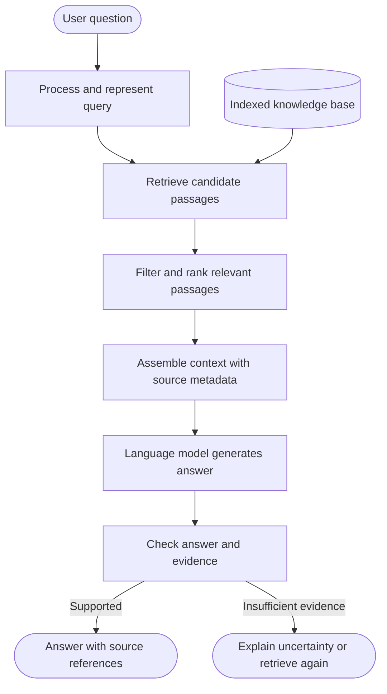
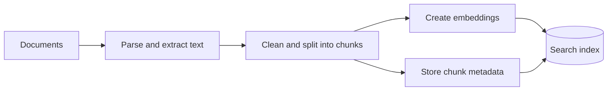
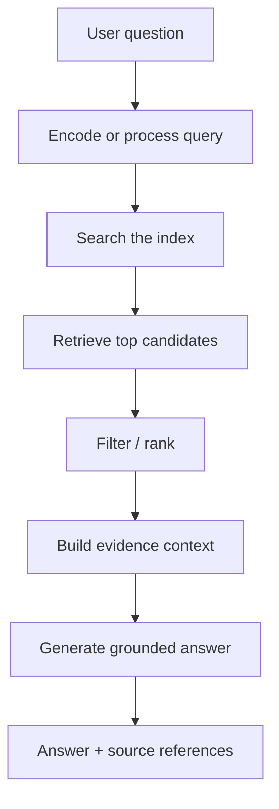

# Module 2 — RAG Fundamentals

**Level:** Beginner → Intermediate  
**Estimated learning time:** 2–3 hours  
**Prerequisites:** Basic Python, familiarity with what an AI model does  
**Project:** Build a small document question-answering system that cites its sources

> **The learning pattern:** understand the problem → learn the concept → follow a worked example → implement a small version → test it → discuss the system-design trade-offs.

## Your learning outcomes

By the end, you should be able to:

- Explain why a language model may need external knowledge.
- Describe retrieval-augmented generation (RAG) from first principles.
- Compare RAG, fine-tuning, and long-context prompting.
- Trace a question through ingestion, retrieval, context assembly, and generation.
- Explain grounding, citations, and common RAG failure modes.
- Implement a simple retrieval pipeline and evaluate its answers.

## Learning roadmap

| Lesson | What you will learn | Checkpoint |
|---|---|---|
| 1. Why RAG exists | Model knowledge, freshness, private data | Explain the knowledge problem |
| 2. What RAG is | Retrieval + generation | Draw the basic pipeline |
| 3. RAG vs alternatives | RAG, fine-tuning, long context | Choose an approach for a scenario |
| 4. Two pipeline stages | Ingestion time vs query time | Trace a document and a question |
| 5. Grounded answers | Context, citations, uncertainty | Identify unsupported claims |
| 6. Build and evaluate | Minimal Python implementation | Run tests and inspect failures |

---

# Lesson 1 — Why do we need RAG?

## 1.1 Start with a familiar example

Imagine your university publishes a new course policy today. You ask a general-purpose language model:

> What is the late-submission policy for my course this semester?

The model may know general academic concepts, but it may not know your university's newest policy or have access to your course's private documents. If it answers anyway, it could produce a plausible-sounding but incorrect response.

This is a **knowledge-access problem**.

A useful AI application often needs information that is:

- **Private:** internal handbooks, company documentation, course notes.
- **Fresh:** current policies, recent product documentation, updated research.
- **Specific:** a particular contract, report, or collection of files.
- **Traceable:** information that must be linked to its supporting source.

RAG addresses this by retrieving relevant information at question time and giving that information to the model as context.

## 1.2 What happens without retrieval?

A model receives a question and generates an answer from the information represented in its parameters and the context supplied in the prompt.

That can work well for general knowledge, but it does not guarantee access to a particular document or recent update.

**Important distinction:** a model's training data is not the same thing as a live, searchable document store.

## Quick checkpoint

1. Why might a model not know a policy published this morning?
2. Why is a confident answer not necessarily a verified answer?
3. Name two situations where an application needs access to external knowledge.

---

# Lesson 2 — What is Retrieval-Augmented Generation?

## 2.1 Definition from first principles

**Retrieval-Augmented Generation (RAG)** is a system pattern in which an application retrieves relevant information from an external knowledge source and supplies it to a generative model so the model can produce an answer grounded in that information.

Break the name into three parts:

- **Retrieval:** find information relevant to the user's question.
- **Augmented:** add the retrieved information to the model's input context.
- **Generation:** use the model to produce a response using the question and supplied context.

The key idea is that the model does not have to rely only on its internal learned parameters. It can use relevant evidence retrieved for the current request.

## 2.2 End-to-end architecture



### Component-by-component explanation

| Component | Responsibility | Example |
|---|---|---|
| User interface / API | Receives the question | "What is the refund window?" |
| Query processing | Normalizes or classifies the question | Detects a policy question |
| Retriever | Finds candidate passages | Searches policy documents |
| Ranker / filter | Prioritizes useful candidates | Prefers the current policy |
| Context builder | Packages passages and metadata | Adds document title and page |
| Generator | Writes an answer from supplied context | Summarizes the refund rule |
| Evidence checker | Checks whether claims are supported | Confirms the source contains the rule |

A production RAG system may use separate services for these components. A small prototype can implement several in one Python program.

## 2.3 A worked example: university policy assistant

Suppose the knowledge base contains these simplified passages:

| ID | Document | Passage |
|---|---|---|
| P1 | Course handbook | "Assignments are normally due by 11:59 PM on the date shown in the course portal." |
| P2 | Late policy | "Late submissions lose 10% of the available marks per calendar day, up to three days." |
| P3 | Extension policy | "Students with an approved extension should follow the revised deadline recorded by the instructor." |

**Question:** "How much is deducted if I submit one day late?"

A basic RAG flow:

1. Convert the question into a search representation.
2. Retrieve P1, P2, and P3 or a smaller relevant subset.
3. Rank P2 highly because it directly mentions late submissions and deductions.
4. Put P2 and its source metadata into the model context.
5. Ask the model to answer using only the supplied evidence.
6. Return the answer with a reference to the Late policy.

**Grounded answer:** "The policy states that late submissions lose 10% of the available marks per calendar day. For one day late, that is a 10% deduction. Source: Late policy."

Notice what the system should not do: invent exceptions, claim to know a student's approved extension, or silently treat an old policy as current.

## 2.4 What does retrieval actually return?

A retriever usually returns passages or chunks, not a fully reasoned final answer. Each result should carry useful metadata.

Example result:

```python
{
    "chunk_id": "policy-002",
    "text": "Late submissions lose 10% ... per calendar day.",
    "source": "Late policy",
    "page": 2,
    "updated_at": "2026-08-15"
}
```

Metadata helps with citations, filtering, version selection, access control, and debugging.

## Checkpoint: trace the request

For the question "Can I submit after the deadline if I have an approved extension?", identify:
- The likely relevant passage.
- Which metadata should be retained.
- What the answer should say if no extension record is available.

---

# Lesson 3 — RAG vs fine-tuning vs long-context prompting

These approaches solve different problems. They can also be combined.

| Approach | Main purpose | Knowledge changes | Good fit | Main limitation |
|---|---|---|---|---|
| RAG | Fetch relevant external evidence at request time | Update the knowledge source / index | Private, fresh, traceable information | Retrieval can miss or select poor evidence |
| Fine-tuning | Change model behavior or specialize patterns | Usually requires another training run for new facts | Style, task behavior, domain patterns | Not a live database; facts can become stale |
| Long-context prompting | Put more supplied material directly in the prompt | Change the supplied prompt context | Small document sets that fit the context window | Context cost, noise, and finite capacity |

### Scenario walkthroughs

**Scenario A: Internal HR handbook changes every month.**  
RAG is usually a strong fit because the application can index the updated handbook and retrieve relevant sections.

**Scenario B: A model must consistently format output in a specialized schema.**  
Prompting, constrained decoding, or fine-tuning may be more relevant than RAG because the challenge is behavior and format, not missing factual evidence.

**Scenario C: A user uploads one short document and asks one question.**  
Directly placing the document in the prompt may be simpler than building a persistent retrieval system.

### Decision rule

Start with the simplest approach that meets the requirements. Do not add a vector database or agent framework just because the application uses an LLM.

## Practice: choose the approach

For each case, choose RAG, fine-tuning, long-context prompting, or a combination. Explain why.

1. A company needs answers grounded in thousands of frequently updated internal documents.
2. A model needs to follow a consistent domain-specific output style.
3. A user asks questions about one short PDF uploaded for the current conversation.
4. A support assistant needs current product documentation and a consistent response format.

**Suggested answers:** 1. RAG. 2. Prompting or fine-tuning, depending on consistency and scale. 3. Long-context prompting may be sufficient. 4. RAG plus prompt constraints; consider fine-tuning only if behavior still needs adaptation.

---

# Lesson 4 — The two stages of a RAG system

A useful way to understand RAG is to separate work done before a question arrives from work done when a question arrives.

## 4.1 Stage A: Offline ingestion and indexing

This stage prepares the knowledge source.



Typical steps:

1. Load documents from approved sources.
2. Extract text and useful structure.
3. Clean irrelevant noise while preserving meaning.
4. Split content into chunks.
5. Create vector embeddings when using dense retrieval.
6. Store chunks, vectors, and metadata in an index.
7. Record document versions and ingestion status.

**Why not process every document from scratch for every question?**  
Preprocessing and indexing make repeated searches faster and more economical.

## 4.2 Stage B: Online query and answer



Typical steps:

1. Receive the question and user permissions.
2. Transform it into a retrieval query.
3. Search the index.
4. Select and rank useful passages.
5. Assemble a context within the model's input budget.
6. Generate an answer constrained by the evidence.
7. Return citations and express uncertainty when evidence is missing.

## 4.3 Follow one document through the system

Suppose a handbook has 30 pages.

- **Ingestion:** extract text from all pages.
- **Chunking:** split the text into meaningful passages.
- **Embedding:** represent each passage as a vector.
- **Indexing:** store vectors alongside text and metadata.
- **Query:** user asks about late submission.
- **Retrieval:** search returns passages related to late policy.
- **Generation:** model summarizes the selected policy passage.

This separation is foundational to later modules on chunking, embeddings, vector search, hybrid retrieval, and reranking.

---

# Lesson 5 — Grounding, citations, and failure modes

## 5.1 What does it mean to ground an answer?

An answer is grounded when its factual claims are supported by the retrieved evidence supplied to the model.

Retrieval alone does not guarantee grounding. A model can still:
- Ignore relevant context.
- Misread a passage.
- Combine facts incorrectly.
- Make a claim that the source does not support.
- Cite a document that is related but does not prove the claim.

## 5.2 Common failure modes

| Failure | What happens | Possible mitigation |
|---|---|---|
| Retrieval miss | Relevant passage is not retrieved | Improve chunking, query processing, and recall |
| Irrelevant retrieval | Search returns similar but unhelpful text | Rerank, filter, improve metadata |
| Stale documents | Old policy outranks the current version | Version metadata and freshness rules |
| Context overload | Too much text distracts the model | Rank and compress evidence |
| Unsupported generation | Answer contains claims absent from sources | Evidence checks and abstention |
| Broken citation | Citation points to the wrong passage | Preserve source IDs and verify references |
| Permission leak | User retrieves documents they cannot access | Enforce authorization during retrieval |

## 5.3 A safe answer pattern

A robust answer should:
1. Answer only what the evidence supports.
2. Attach source references to relevant claims.
3. Distinguish direct evidence from inference.
4. Say when the retrieved material is insufficient.
5. Avoid pretending that missing information was verified.

**Example:** If the handbook explains the standard late policy but contains no record of a particular student's extension, the assistant can explain the standard policy and say it cannot determine the student's individual extension status from the available documents.

## 5.4 Evaluation: how do we know RAG works?

Evaluate retrieval and generation separately.

| Layer | Example metric / check | What it tells you |
|---|---|---|
| Retrieval | Recall@K | Did relevant evidence appear in the top K results? |
| Ranking | MRR or NDCG | Were the most useful results ranked near the top? |
| Generation | Answer correctness | Is the response factually correct? |
| Grounding | Faithfulness / claim support | Are claims supported by retrieved evidence? |
| Citation | Citation precision | Do references support the claims they accompany? |
| System | Latency and cost | Is the system practical to operate? |

A good evaluation set contains representative questions, expected answers, relevant source passages, and known unanswerable questions. Include difficult cases, not only easy examples.

---

# Lesson 6 — Build a minimal RAG prototype

This first prototype uses a tiny in-memory document collection and transparent keyword overlap. It is deliberately simple: the goal is to understand the retrieval-to-generation boundary before adding embeddings or a vector database.

## 6.1 Minimal retriever in Python

```python
import re
from collections import Counter

documents = [
    {
        "id": "P1",
        "source": "Course handbook",
        "text": "Assignments are normally due by 11:59 PM on the date shown in the course portal."
    },
    {
        "id": "P2",
        "source": "Late policy",
        "text": "Late submissions lose 10 percent of available marks per calendar day, up to three days."
    },
    {
        "id": "P3",
        "source": "Extension policy",
        "text": "Students with an approved extension should follow the revised deadline recorded by the instructor."
    },
]

def tokenize(text):
    return re.findall(r"[a-z0-9]+", text.lower())

def retrieve(query, docs, k=2):
    query_terms = set(tokenize(query))
    ranked = []

    for doc in docs:
        document_terms = Counter(tokenize(doc["text"]))
        score = sum(document_terms[term] for term in query_terms)
        ranked.append((score, doc))

    ranked.sort(key=lambda item: item[0], reverse=True)
    return [doc for score, doc in ranked[:k] if score > 0]

def build_context(results):
    return "\n\n".join(
        f"Source: {doc['source']} ({doc['id']})\n{doc['text']}"
        for doc in results
    )

question = "How much is deducted for one day late?"
results = retrieve(question, documents)
context = build_context(results)

print("RETRIEVED EVIDENCE")
print(context)
```

This prototype does not call an LLM. It demonstrates how retrieval selects evidence and how the application can package that evidence for a later generation step.

## 6.2 Add a generation boundary

In a real application, pass the question and retrieved context to a model through your chosen provider's SDK. Keep the prompt explicit:

```text
Answer the question using only the evidence below.
If the evidence does not answer the question, say so.
Do not invent policy details.
Include the source ID for each policy claim.

QUESTION:
{question}

EVIDENCE:
{context}
```

The model's output still needs evaluation. Prompt instructions are not a substitute for evidence validation, access control, or tests.

## 6.3 Test the retriever

```python
def test_late_policy_is_retrieved():
    results = retrieve("late submission deduction", documents)
    ids = {doc["id"] for doc in results}
    assert "P2" in ids

def test_extension_policy_is_retrieved():
    results = retrieve("approved extension revised deadline", documents)
    ids = {doc["id"] for doc in results}
    assert "P3" in ids

test_late_policy_is_retrieved()
test_extension_policy_is_retrieved()
print("Retriever tests passed")
```

**Prototype limitation:** keyword overlap is not semantic search. It may miss paraphrases, overvalue common words, and fail to understand meaning. Later modules will introduce BM25, embeddings, vector search, hybrid retrieval, and reranking.

## 6.4 Mini design review

Before calling the prototype complete, answer:

- What happens when no documents match?
- How would you prevent an outdated policy from being retrieved?
- How would you ensure users only retrieve documents they are allowed to see?
- How would you cite a particular page or paragraph?
- What would you measure before choosing a better retriever?

---

# Lesson 7 — System design perspective

## 7.1 Requirements for a document Q&A system

**Functional requirements**
- Ingest approved documents.
- Accept natural-language questions.
- Retrieve relevant passages.
- Generate answers with references.
- Indicate when evidence is insufficient.

**Non-functional requirements**
- Low and predictable latency.
- Access control and privacy.
- Source traceability.
- High retrieval quality.
- Resilience to unavailable or malformed documents.
- Observable cost and model usage.

## 7.2 Design trade-offs

| Decision | Option A | Option B | Trade-off |
|---|---|---|---|
| Search | Keyword | Dense vector | Exact terms vs semantic similarity |
| Index | In-memory | Managed vector database | Simplicity vs scale and operations |
| Context | More passages | Fewer ranked passages | Recall vs noise, latency, and token cost |
| Freshness | Scheduled reindex | Event-driven updates | Simplicity vs update delay |
| Answer policy | Always answer | Abstain when unsupported | Coverage vs reliability |

Start with the smallest architecture that meets the product requirements. Measure before adding complexity.

## 7.3 Interview-style walkthrough

**Prompt:** Design a company handbook assistant that answers employee questions and cites the source policy.

A strong answer should cover:

1. Clarify users, document types, update frequency, access permissions, and expected traffic.
2. Describe ingestion, parsing, chunking, indexing, and versioning.
3. Trace the online path from query to retrieval to grounded answer.
4. Explain how authorization is enforced before evidence reaches the model.
5. Handle stale documents, retrieval misses, model errors, and unsupported questions.
6. Define retrieval, grounding, citation, latency, and cost metrics.
7. Explain why a simple RAG pipeline is sufficient initially and when hybrid retrieval or reranking becomes worthwhile.

---

# Practice set — answer before checking the solutions

## A. Multiple-choice questions

**1. What is the main purpose of retrieval in RAG?**

A. Change the model's parameters  
B. Find relevant external information for the current request  
C. Guarantee every generated claim is correct  
D. Replace the language model

**2. Which operation normally belongs to offline ingestion?**

A. Receive the user's question  
B. Generate the final answer  
C. Parse and index documents  
D. Select a response tone

**3. What is the main role of chunk metadata?**

A. Increase model parameter count  
B. Support source tracking, filtering, and document management  
C. Replace document text  
D. Guarantee semantic similarity

**4. A user asks about a policy that is not in the retrieved evidence. What should a reliable system do?**

A. Guess based on common practice  
B. Invent a likely citation  
C. Clearly state that the available evidence is insufficient  
D. Always return the longest retrieved passage

**5. Which metric is commonly used to evaluate whether relevant items appear in the top K retrieval results?**

A. Recall@K  
B. GPU utilization  
C. BLEU only  
D. Model parameter count

## B. Short-answer questions (2–3 marks)

1. Define RAG and explain its three stages.
2. Give two reasons why an application might need RAG.
3. Differentiate RAG and fine-tuning.
4. What is the difference between ingestion time and query time?
5. Why should a RAG system preserve source metadata?
6. Explain two common RAG failure modes and one mitigation for each.
7. Why is retrieval quality not the same as answer quality?

## C. Calculation and reasoning

**1. Chunk count**

A document contains 1,000 tokens. You split it into chunks of 200 tokens with no overlap. How many chunks are created?

**2. Chunk count with overlap**

A document contains 1,000 tokens. Chunk size is 200 tokens and overlap is 50 tokens. Assuming chunks advance by 150 tokens and the final chunk may be shorter, how many chunks are required?

**3. Recall@K**

For a question, there are 5 known relevant passages. A retriever returns 10 passages, of which 4 are relevant. Calculate Recall@10.

**4. Context budget**

A model request has a context budget of 8,000 tokens. The system reserves 1,000 tokens for instructions and 1,000 tokens for the expected answer. If each retrieved passage averages 500 tokens, how many complete passages can fit in the remaining budget?

## D. Applied design exercise

Design a RAG assistant for a university policy portal.

Include:
- A Mermaid architecture diagram.
- The ingestion and query-time workflows.
- A small example of a retrieved passage with source metadata.
- How you would handle old policy versions.
- How you would protect restricted student records.
- Three evaluation metrics.
- One failure scenario and its mitigation.

---

# Answer key

## Multiple choice
1. **B** — retrieval finds relevant external evidence for the current request.
2. **C** — parsing and indexing prepare the knowledge base before a user query.
3. **B** — metadata supports citations, filtering, access decisions, and lifecycle management.
4. **C** — a reliable system communicates evidence limits rather than guessing.
5. **A** — Recall@K measures the fraction of known relevant items found in the top K.

## Short answers — key points
1. RAG retrieves relevant external passages, adds them to the model context, and generates an evidence-informed response.
2. Fresh information, private information, traceable source evidence, or large document collections.
3. RAG fetches external evidence at query time; fine-tuning changes model behavior/parameters through training.
4. Ingestion prepares and indexes documents; query time retrieves evidence and generates a response.
5. Metadata makes it possible to cite, filter, version, authorize, and debug retrieved passages.
6. Retrieval miss → improve chunking/query/retrieval; stale content → version and freshness controls; unsupported generation → evidence checks and abstention.
7. Retrieval measures which evidence was found; answer quality measures whether the generated response is correct and supported.

## Calculation solutions
1. (1000 / 200 = 5) chunks.
2. Starts at token positions 0, 150, 300, 450, 600, 750, and 900: **7 chunks**.
3. Recall@10 (= 4/5 = 0.8 = 80\%\).
4. Available for passages (= 8000 - 1000 - 1000 = 6000) tokens. (6000/500 = 12) passages.

## Completion checklist

- [ ] I can explain RAG without memorizing a definition.
- [ ] I can draw and explain both pipeline stages.
- [ ] I can choose between RAG, fine-tuning, and long context.
- [ ] I can trace one question from query to cited answer.
- [ ] I can run the Python retriever and tests.
- [ ] I can explain retrieval misses, stale data, unsupported answers, and access control.
- [ ] I can answer the practice questions and defend a basic architecture.

## Further reading

Use these as starting points, then read the original papers or documentation:

1. **Retrieval-Augmented Generation for Knowledge-Intensive NLP Tasks** — Lewis et al. (2020): https://arxiv.org/abs/2005.11401
2. **Dense Passage Retrieval for Open-Domain Question Answering** — Karpukhin et al. (2020): https://arxiv.org/abs/2004.04906
3. **BEIR: A Heterogeneous Benchmark for Zero-shot Evaluation of Information Retrieval Models** — Thakur et al. (2021): https://arxiv.org/abs/2104.08663

### Paper reading notes

For each paper, record: problem, assumptions, method, architecture, evaluation setup, findings, limitations, and one idea you would test in your own implementation.

---

## Next module

**Module 3 — Document Processing & Embeddings:** learn how raw PDFs, web pages, and files become clean, searchable chunks and vector representations.
