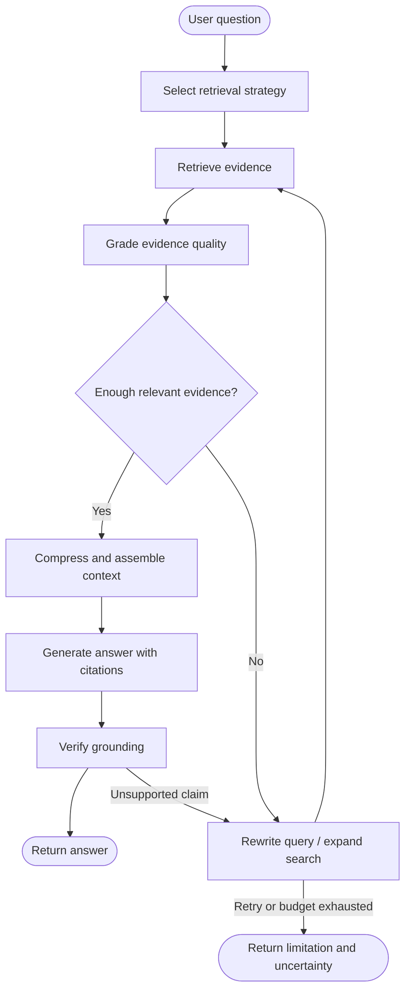

# Module 6 — Advanced RAG

**Curriculum:** v1  
**Level:** Intermediate → Advanced  
**Goal:** Understand the architecture, explain design decisions, and implement the core ideas.

## Architecture diagram

> This is a conceptual reference architecture. Adapt the components and control flow to the system requirements.

---

## Learning outcomes

By completing this module, you should be able to explain each topic below, draw and critique the architecture, implement the core ideas, evaluate the result, and discuss limitations and trade-offs.

## Topics

1. Context assembly and contextual compression
2. Multi-hop and iterative retrieval
3. Self-RAG
4. Corrective RAG (CRAG)
5. Adaptive RAG
6. Agentic RAG
7. Graph RAG and knowledge graphs
8. RAG evaluation and error analysis

## Implementation milestone

Build and evaluate an advanced RAG workflow.

## System design review checklist

- [ ] Clarify functional and non-functional requirements.
- [ ] Explain the role and responsibility of every component.
- [ ] Walk through a complete request and data flow.
- [ ] Identify trust boundaries, failure modes, and recovery behavior.
- [ ] Discuss latency, throughput, cost, scalability, and trade-offs.
- [ ] Define evaluation metrics and a test strategy.
- [ ] Implement a small working version and document its limitations.

## Interview practice

Use the [module-wise question bank](interview-preparation/MODULE_WISE_QUESTIONS.md) and [company engineering practices](COMPANY_PRACTICES.md) to practice explaining this module from first principles.

## Related resources

- [All architecture diagrams](architecture-diagrams/README.md)
- [Full curriculum](CURRICULUM.md)
- [Company engineering practices](COMPANY_PRACTICES.md)
