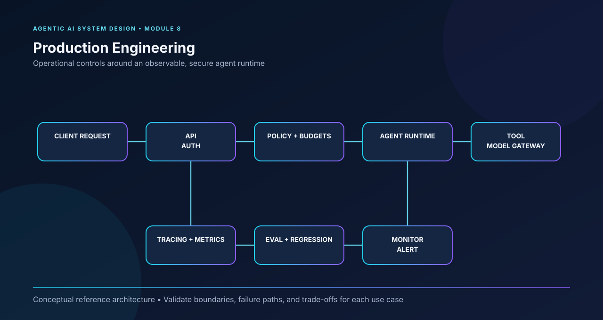

# Module 8 — Production Engineering

**Curriculum:** v1  
**Level:** Intermediate → Advanced  
**Goal:** Understand the architecture, explain design decisions, and implement the core ideas.

## Architecture diagram

Production controls surround the agent runtime with authentication, policy enforcement, observability, evaluation, and monitoring.

[Open the full-size SVG](architecture-diagrams/module-8.svg).

> Diagram flow: Client request → API/auth → policy and budgets → agent runtime → tool/model gateway; traces → evaluation → monitoring feed back into operations.  
> This is a conceptual reference architecture. Adapt components and control flow to the system requirements; it is not a mandatory implementation blueprint.

---

## Learning outcomes

By completing this module, you should be able to explain each topic below, draw and critique the architecture, implement the core ideas, evaluate the result, and discuss limitations and trade-offs.

## Topics

1. Evaluation datasets and offline evaluation
2. Tracing, observability, and debugging
3. Reliability, retries, timeouts, and fallbacks
4. Latency, throughput, and cost optimization
5. Caching and model routing
6. Security boundaries and prompt-injection risks
7. Data privacy and access control
8. Deployment, monitoring, and regression testing

## Implementation milestone

Add tests, traces, metrics, bounded retries, security checks, and deployment documentation.

## System design review checklist

- [ ] Clarify functional and non-functional requirements.
- [ ] Explain the role and responsibility of every component.
- [ ] Walk through a complete request and data flow.
- [ ] Identify trust boundaries, failure modes, and recovery behavior.
- [ ] Discuss latency, throughput, cost, scalability, and trade-offs.
- [ ] Define evaluation metrics and a test strategy.
- [ ] Implement a small working version and document its limitations.

## Interview practice

Use the [module-wise question bank](interview-preparation/MODULE_WISE_QUESTIONS.md) and [company engineering practices](COMPANY_PRACTICES.md) to practice explaining this module from first principles.

## Related resources

- [All architecture diagrams](architecture-diagrams/README.md)
- [Full curriculum](CURRICULUM.md)
- [Company engineering practices](COMPANY_PRACTICES.md)
