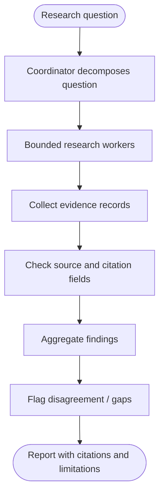

# Anthropic: Bounded parallel research workflow

> **Portfolio exercise, not a claim about proprietary internals.** This case study translates public engineering themes into an original, small reference implementation. It is not an exact reproduction of the company's production architecture.

## 1. Public source and analysis

**Primary source:** [Anthropic public engineering source](https://www.anthropic.com/engineering/multi-agent-research-system)

**Design problem:** A research task can be decomposed into independent subquestions, investigated in parallel, and synthesized with source provenance and conflict awareness.

**What the source supports:** Use the linked public source to understand the organization's documented principles. The architecture and implementation below are this repository's educational interpretation; do not attribute every component or design choice to the company.

**Requirements**
- Functional: complete the target workflow and return useful output.
- Reliability: handle invalid inputs and expected failures explicitly.
- Security: enforce trust boundaries in deterministic code.
- Observability: expose outcomes and useful counters.
- Cost/latency: bound concurrency, retries, context, or batch size as appropriate.

## 2. Mermaid architecture



## 3. Component breakdown

Use a coordinator to create focused subtasks, bounded workers to gather evidence, and a synthesis stage to consolidate findings. Keep source URL and excerpt attached to each claim. Parallelism is bounded to control cost and avoid unbounded fan-out.

| Component | Responsibility | Key invariant |
|---|---|---|
| Request boundary | Validate caller input and identity | Untrusted input is never policy |
| Coordinator | Select the next workflow step | Work remains bounded |
| Policy / control layer | Enforce permissions and budgets | Deny by default |
| Execution adapter | Call a narrowly scoped operation | Validate before side effects |
| State / evidence | Preserve progress and provenance | State is explicit and auditable |
| Evaluation / telemetry | Measure outcomes and failures | Metrics reflect user-visible results |

## 4. Python implementation

The runnable implementation is in [`agent.py`](agent.py). It uses only the Python standard library and intentionally substitutes deterministic functions for external models or services.

```python
from concurrent.futures import ThreadPoolExecutor, as_completed
from dataclasses import dataclass

@dataclass(frozen=True)
class Finding:
    question: str
    claim: str
    source_url: str

def run_research(subquestions, researcher, max_workers=3):
    if max_workers < 1:
        raise ValueError("max_workers must be positive")
    results = []
    with ThreadPoolExecutor(max_workers=max_workers) as pool:
        futures = [pool.submit(researcher, q) for q in subquestions]
        for future in as_completed(futures):
            finding = future.result()
            if not finding.source_url.startswith(("https://", "http://")):
                raise ValueError("Finding must include an HTTP(S) source")
            results.append(finding)
    return sorted(results, key=lambda item: item.question)

def conflicting_claims(findings):
    claims = {}
    for item in findings:
        claims.setdefault(item.question, set()).add(item.claim)
    return {q: sorted(values) for q, values in claims.items() if len(values) > 1}
```

## 5. Unit tests

Tests are in [`test_agent.py`](test_agent.py).

```python
import unittest
from agent import Finding, run_research, conflicting_claims

class ResearchTests(unittest.TestCase):
    def researcher(self, question):
        return Finding(question, "evidence for " + question, "https://example.org/source")

    def test_returns_all_subquestions(self):
        result = run_research(["scope", "limits"], self.researcher, max_workers=2)
        self.assertEqual([x.question for x in result], ["limits", "scope"])

    def test_requires_source_url(self):
        with self.assertRaises(ValueError):
            run_research(["q"], lambda q: Finding(q, "claim", "file://local"), 1)

    def test_detects_disagreement(self):
        items = [Finding("q", "yes", "https://a.org"), Finding("q", "no", "https://b.org")]
        self.assertEqual(conflicting_claims(items), {"q": ["no", "yes"]})

if __name__ == "__main__":
    unittest.main()
```

Run from this directory:

```bash
python -m unittest -v
```

## 6. Evaluation plan

Track subquestion coverage, source validity, citation completeness, conflicting-claim detection, factual support judged against sources, report usefulness, worker failure rate, wall-clock latency, and cost. Compare serial versus bounded-parallel execution.

Suggested experiment table:

| Experiment | Baseline | Variant | Metrics |
|---|---|---|---|
| Normal workload | Simple sequential/reference behavior | Proposed pattern | Success, latency, cost |
| Invalid or adversarial input | No control / test harness | Validation and policy enabled | Rejection correctness |
| Failure injection | No recovery | Bounded recovery | Recovery rate, duplicate effects |
| Load / scale | Low concurrency | Increased concurrency | Throughput, tail latency, resource use |

Record the dataset, environment, sample count, and measured results. Do not report hypothetical targets as experimental results.

## 7. Design trade-offs

Parallel workers reduce elapsed time for independent questions but increase cost, coordination overhead, and the chance of duplicated or inconsistent evidence. Use serial execution for dependent tasks; parallelize only independent subtasks. Synthesis must preserve disagreement rather than average it away.

## 8. Limitations and production gaps

The example uses local Python threads and a supplied researcher function. It does not browse the web, verify source truth, or implement model-based planning. A production system needs source quality scoring, timeout handling, cancellation, retry policy, and human review for high-impact conclusions.

## 9. Extension exercises

- Replace the deterministic stub with a typed adapter behind the same interface.
- Add structured traces with a correlation ID and per-step timing.
- Add configuration and tests for one additional failure mode.
- Create a small evaluation dataset and report measured results.
- Draw a revised Mermaid diagram after implementing your changes.

## 10. Design review questions

1. Which component is trusted, and why?
2. What happens when a dependency is slow or unavailable?
3. Which state must survive a process restart?
4. What is the system's most important correctness invariant?
5. Which metric would reveal a regression first?
6. What would you simplify if the system had a strict latency or cost budget?
