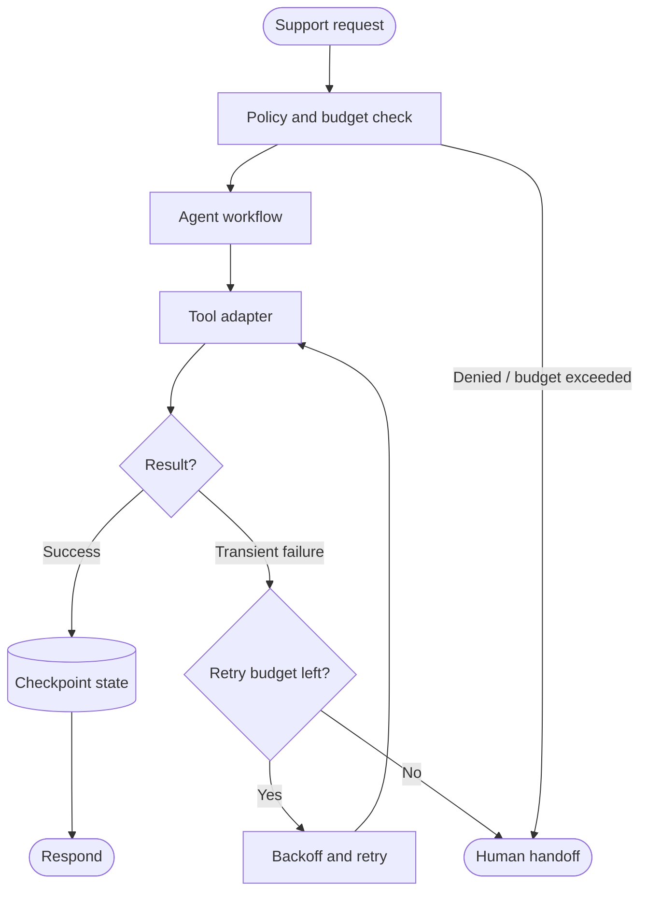

# AWS: Resilient bounded customer-support workflow

> **Portfolio exercise, not a claim about proprietary internals.** This case study translates public engineering themes into an original, small reference implementation. It is not an exact reproduction of the company's production architecture.

## 1. Public source and analysis

**Primary source:** [AWS public engineering source](https://docs.aws.amazon.com/wellarchitected/latest/agentic-ai-lens/agentic-ai-lens.html)

**Design problem:** A customer-support agent needs bounded retries, explicit budgets, idempotent actions, and a human fallback when tools fail or the workflow becomes uncertain.

**What the source supports:** Use the linked public source to understand the organization's documented principles. The architecture and implementation below are this repository's educational interpretation; do not attribute every component or design choice to the company.

**Requirements**
- Functional: complete the target workflow and return useful output.
- Reliability: handle invalid inputs and expected failures explicitly.
- Security: enforce trust boundaries in deterministic code.
- Observability: expose outcomes and useful counters.
- Cost/latency: bound concurrency, retries, context, or batch size as appropriate.

## 2. Mermaid architecture



## 3. Component breakdown

Wrap tool calls in explicit timeout, retry, and budget policies. Retry only transient failures and use idempotency keys for side-effecting operations. Persist checkpoints so a restart does not blindly repeat completed work. Escalate after bounded attempts.

| Component | Responsibility | Key invariant |
|---|---|---|
| Request boundary | Validate caller input and identity | Untrusted input is never policy |
| Coordinator | Select the next workflow step | Work remains bounded |
| Policy / control layer | Enforce permissions and budgets | Deny by default |
| Execution adapter | Call a narrowly scoped operation | Validate before side effects |
| State / evidence | Preserve progress and provenance | State is explicit and auditable |
| Evaluation / telemetry | Measure outcomes and failures | Metrics reflect user-visible results |

## 4. Python implementation

The runnable implementation is in [`agent.py`](agent.py). It uses only the Python standard library and intentionally substitutes deterministic functions for external models or services.

```python
from dataclasses import dataclass, field

@dataclass
class WorkflowState:
    completed: dict = field(default_factory=dict)
    attempts: dict = field(default_factory=dict)

def run_step(state, step_id, operation, max_attempts=3, retryable=(TimeoutError,)):
    if step_id in state.completed:
        return state.completed[step_id]
    if max_attempts < 1:
        raise ValueError("max_attempts must be positive")
    for attempt in range(1, max_attempts + 1):
        state.attempts[step_id] = attempt
        try:
            result = operation()
            state.completed[step_id] = result
            return result
        except retryable:
            if attempt == max_attempts:
                raise
    raise RuntimeError("unreachable")
```

## 5. Unit tests

Tests are in [`test_agent.py`](test_agent.py).

```python
import unittest
from agent import WorkflowState, run_step

class ResilienceTests(unittest.TestCase):
    def test_retries_transient_failure(self):
        state = WorkflowState()
        calls = {"n": 0}
        def flaky():
            calls["n"] += 1
            if calls["n"] < 3:
                raise TimeoutError("temporary")
            return "ok"
        self.assertEqual(run_step(state, "lookup", flaky, 3), "ok")
        self.assertEqual(calls["n"], 3)

    def test_completed_step_is_not_repeated(self):
        state = WorkflowState(completed={"charge": "done"})
        self.assertEqual(run_step(state, "charge", lambda: "again"), "done")

    def test_non_retryable_error_propagates(self):
        with self.assertRaises(ValueError):
            run_step(WorkflowState(), "bad", lambda: (_ for _ in ()).throw(ValueError()), 3)

if __name__ == "__main__":
    unittest.main()
```

Run from this directory:

```bash
python -m unittest -v
```

## 6. Evaluation plan

Measure task completion, retry count, duplicate side effects, timeout rate, recovery after restart, escalation rate, cost per task, and tail latency. Inject transient and permanent failures; verify that retry budgets are respected.

Suggested experiment table:

| Experiment | Baseline | Variant | Metrics |
|---|---|---|---|
| Normal workload | Simple sequential/reference behavior | Proposed pattern | Success, latency, cost |
| Invalid or adversarial input | No control / test harness | Validation and policy enabled | Rejection correctness |
| Failure injection | No recovery | Bounded recovery | Recovery rate, duplicate effects |
| Load / scale | Low concurrency | Increased concurrency | Throughput, tail latency, resource use |

Record the dataset, environment, sample count, and measured results. Do not report hypothetical targets as experimental results.

## 7. Design trade-offs

Retries improve resilience for transient failures but can amplify load and duplicate side effects. Retry only known transient errors, use exponential backoff with jitter in production, and persist idempotency/checkpoint state. Human handoff protects users when confidence or budget is exhausted.

## 8. Limitations and production gaps

The example has no real clock, persistence, jitter, or distributed idempotency. Production needs durable state, cancellation, deadline propagation, circuit breakers, dead-letter handling, and clear customer communication.

## 9. Extension exercises

- Replace the deterministic stub with a typed adapter behind the same interface.
- Add structured traces with a correlation ID and per-step timing.
- Add configuration and tests for one additional failure mode.
- Create a small evaluation dataset and report measured results.
- Draw a revised Mermaid diagram after implementing your changes.

## 10. Design review questions

1. Which component is trusted, and why?
2. What happens when a dependency is slow or unavailable?
3. Which state must survive a process restart?
4. What is the system's most important correctness invariant?
5. Which metric would reveal a regression first?
6. What would you simplify if the system had a strict latency or cost budget?
