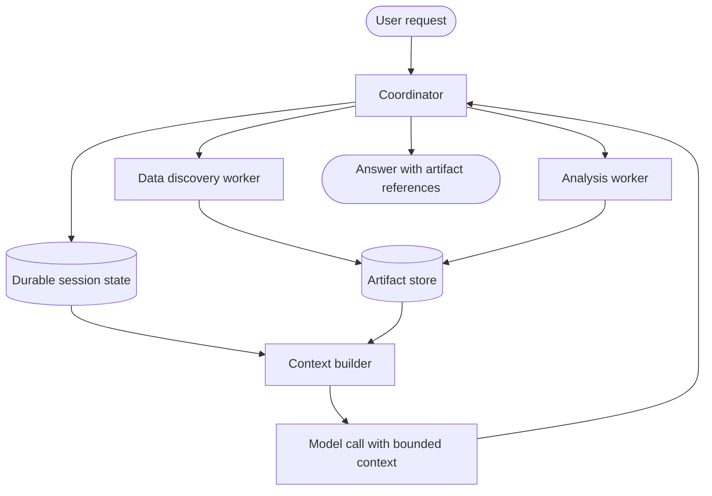

# Google: Context-aware multi-agent analytics workflow

> **Portfolio exercise, not a claim about proprietary internals.** This case study translates public engineering themes into an original, small reference implementation. It is not an exact reproduction of the company's production architecture.

## 1. Public source and analysis

**Primary source:** [Google public engineering source](https://docs.cloud.google.com/architecture/agentic-ai-overview)

**Design problem:** A multi-step analytics workflow needs to distinguish durable session state from compact per-call working context and large artifacts.

**What the source supports:** Use the linked public source to understand the organization's documented principles. The architecture and implementation below are this repository's educational interpretation; do not attribute every component or design choice to the company.

**Requirements**
- Functional: complete the target workflow and return useful output.
- Reliability: handle invalid inputs and expected failures explicitly.
- Security: enforce trust boundaries in deterministic code.
- Observability: expose outcomes and useful counters.
- Cost/latency: bound concurrency, retries, context, or batch size as appropriate.

## 2. Mermaid architecture



## 3. Component breakdown

Persist compact task state and artifact references separately. Build each model-call context from the current goal, relevant recent events, selected memory, and artifact summaries. Do not repeatedly inject entire datasets or full transcripts.

| Component | Responsibility | Key invariant |
|---|---|---|
| Request boundary | Validate caller input and identity | Untrusted input is never policy |
| Coordinator | Select the next workflow step | Work remains bounded |
| Policy / control layer | Enforce permissions and budgets | Deny by default |
| Execution adapter | Call a narrowly scoped operation | Validate before side effects |
| State / evidence | Preserve progress and provenance | State is explicit and auditable |
| Evaluation / telemetry | Measure outcomes and failures | Metrics reflect user-visible results |

## 4. Python implementation

The runnable implementation is in [`agent.py`](agent.py). It uses only the Python standard library and intentionally substitutes deterministic functions for external models or services.

```python
from dataclasses import dataclass, field

@dataclass
class Session:
    goal: str
    events: list = field(default_factory=list)
    artifacts: dict = field(default_factory=dict)

def add_artifact(session, artifact_id, summary, location):
    session.artifacts[artifact_id] = {"summary": summary, "location": location}

def build_context(session, token_budget=120):
    if token_budget <= 0:
        raise ValueError("token_budget must be positive")
    header = f"Goal: {session.goal}"
    recent = session.events[-5:]
    artifact_lines = [
        f"{key}: {value['summary']} (ref: {value['location']})"
        for key, value in session.artifacts.items()
    ]
    pieces = [header] + recent + artifact_lines
    selected = []
    used = 0
    for piece in pieces:
        cost = max(1, len(piece.split()))
        if used + cost <= token_budget:
            selected.append(piece)
            used += cost
    return "\n".join(selected)
```

## 5. Unit tests

Tests are in [`test_agent.py`](test_agent.py).

```python
import unittest
from agent import Session, add_artifact, build_context

class ContextTests(unittest.TestCase):
    def test_artifact_is_referenced(self):
        session = Session("Analyze sales")
        add_artifact(session, "table-1", "monthly totals", "artifact://table-1")
        self.assertIn("artifact://table-1", build_context(session))

    def test_context_obeys_word_budget(self):
        session = Session("summarize")
        session.events = ["one two three", "four five six"]
        context = build_context(session, token_budget=4)
        self.assertLessEqual(len(context.split()), 4)

    def test_invalid_budget_rejected(self):
        with self.assertRaises(ValueError):
            build_context(Session("goal"), 0)

if __name__ == "__main__":
    unittest.main()
```

Run from this directory:

```bash
python -m unittest -v
```

## 6. Evaluation plan

Measure context-token usage, task completion, retrieval of required state, stale-context errors, artifact dereference success, latency, and cost. Test long sessions to ensure relevant state survives summarization and truncation.

Suggested experiment table:

| Experiment | Baseline | Variant | Metrics |
|---|---|---|---|
| Normal workload | Simple sequential/reference behavior | Proposed pattern | Success, latency, cost |
| Invalid or adversarial input | No control / test harness | Validation and policy enabled | Rejection correctness |
| Failure injection | No recovery | Bounded recovery | Recovery rate, duplicate effects |
| Load / scale | Low concurrency | Increased concurrency | Throughput, tail latency, resource use |

Record the dataset, environment, sample count, and measured results. Do not report hypothetical targets as experimental results.

## 7. Design trade-offs

Compact context reduces token cost and distraction but risks omitting relevant details. Durable state improves continuity but needs lifecycle and privacy controls. Artifact references avoid copying large payloads but introduce storage availability and access-control dependencies.

## 8. Limitations and production gaps

The demo estimates tokens by word count and stores artifacts in memory. Production needs model-specific token counting, durable storage, artifact ACLs, summarization evaluation, retention policy, and recovery after process restarts.

## 9. Extension exercises

- Replace the deterministic stub with a typed adapter behind the same interface.
- Add structured traces with a correlation ID and per-step timing.
- Add configuration and tests for one additional failure mode.
- Create a small evaluation dataset and report measured results.
- Draw a revised Mermaid diagram after implementing your changes.

## 10. Design review questions

1. Which component is trusted, and why?
2. What happens when a dependency is slow or unavailable?
3. Which state must survive a process restart?
4. What is the system's most important correctness invariant?
5. Which metric would reveal a regression first?
6. What would you simplify if the system had a strict latency or cost budget?
