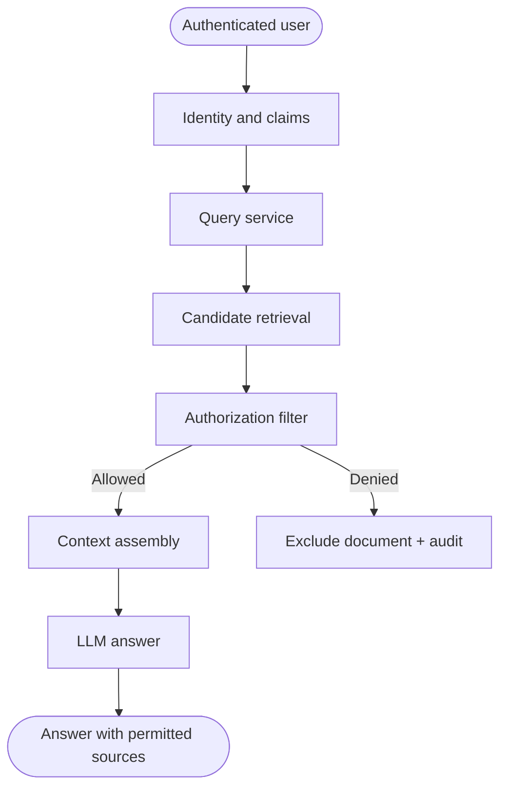

# Microsoft: Permission-aware enterprise retrieval

> **Portfolio exercise, not a claim about proprietary internals.** This case study translates public engineering themes into an original, small reference implementation. It is not an exact reproduction of the company's production architecture.

## 1. Public source and analysis

**Primary source:** [Microsoft public engineering source](https://developer.microsoft.com/en-us/blog/designing-multi-agent-intelligence/)

**Design problem:** An enterprise assistant must retrieve only documents the requesting user is authorized to access, and preserve identity and audit context across components.

**What the source supports:** Use the linked public source to understand the organization's documented principles. The architecture and implementation below are this repository's educational interpretation; do not attribute every component or design choice to the company.

**Requirements**
- Functional: complete the target workflow and return useful output.
- Reliability: handle invalid inputs and expected failures explicitly.
- Security: enforce trust boundaries in deterministic code.
- Observability: expose outcomes and useful counters.
- Cost/latency: bound concurrency, retries, context, or batch size as appropriate.

## 2. Mermaid architecture



## 3. Component breakdown

Treat identity as request context supplied by a trusted authentication layer, not model-generated text. Apply authorization before content enters the model context. Record allow/deny decisions and re-check permissions before any write or downstream action.

| Component | Responsibility | Key invariant |
|---|---|---|
| Request boundary | Validate caller input and identity | Untrusted input is never policy |
| Coordinator | Select the next workflow step | Work remains bounded |
| Policy / control layer | Enforce permissions and budgets | Deny by default |
| Execution adapter | Call a narrowly scoped operation | Validate before side effects |
| State / evidence | Preserve progress and provenance | State is explicit and auditable |
| Evaluation / telemetry | Measure outcomes and failures | Metrics reflect user-visible results |

## 4. Python implementation

The runnable implementation is in [`agent.py`](agent.py). It uses only the Python standard library and intentionally substitutes deterministic functions for external models or services.

```python
from dataclasses import dataclass

@dataclass(frozen=True)
class Document:
    doc_id: str
    text: str
    allowed_users: frozenset

def retrieve_for_user(user_id, query, documents):
    query_terms = set(query.lower().split())
    visible = []
    audit = []
    for doc in documents:
        allowed = user_id in doc.allowed_users
        audit.append({"doc_id": doc.doc_id, "user": user_id, "allowed": allowed})
        if allowed and query_terms.intersection(doc.text.lower().split()):
            visible.append(doc)
    return visible, audit
```

## 5. Unit tests

Tests are in [`test_agent.py`](test_agent.py).

```python
import unittest
from agent import Document, retrieve_for_user

class AccessTests(unittest.TestCase):
    def setUp(self):
        self.docs = [
            Document("public", "quarterly revenue overview", frozenset({"alice", "bob"})),
            Document("private", "acquisition planning details", frozenset({"alice"})),
        ]

    def test_user_sees_only_authorized_matches(self):
        visible, _ = retrieve_for_user("bob", "acquisition planning", self.docs)
        self.assertEqual(visible, [])

    def test_authorized_user_can_retrieve(self):
        visible, _ = retrieve_for_user("alice", "acquisition planning", self.docs)
        self.assertEqual([d.doc_id for d in visible], ["private"])

    def test_audit_records_denied_documents(self):
        _, audit = retrieve_for_user("bob", "revenue", self.docs)
        denied = [entry for entry in audit if not entry["allowed"]]
        self.assertEqual(len(denied), 1)

if __name__ == "__main__":
    unittest.main()
```

Run from this directory:

```bash
python -m unittest -v
```

## 6. Evaluation plan

Measure unauthorized disclosure rate (target zero), authorization-filter correctness, retrieval recall among authorized documents, audit completeness, permission-change propagation delay, and latency overhead. Test cross-user isolation and permission revocation.

Suggested experiment table:

| Experiment | Baseline | Variant | Metrics |
|---|---|---|---|
| Normal workload | Simple sequential/reference behavior | Proposed pattern | Success, latency, cost |
| Invalid or adversarial input | No control / test harness | Validation and policy enabled | Rejection correctness |
| Failure injection | No recovery | Bounded recovery | Recovery rate, duplicate effects |
| Load / scale | Low concurrency | Increased concurrency | Throughput, tail latency, resource use |

Record the dataset, environment, sample count, and measured results. Do not report hypothetical targets as experimental results.

## 7. Design trade-offs

Filtering after candidate retrieval can be efficient but must happen before text is exposed to the model; metadata filters pushed into the retrieval store can reduce leakage and compute. Central identity propagation simplifies policy but creates dependency on the identity provider.

## 8. Limitations and production gaps

This toy example uses static user allowlists and keyword matching. Production requires authenticated claims, group/role resolution, tenant isolation, document-level ACL synchronization, deny-by-default behavior, and tests for revoked permissions.

## 9. Extension exercises

- Replace the deterministic stub with a typed adapter behind the same interface.
- Add structured traces with a correlation ID and per-step timing.
- Add configuration and tests for one additional failure mode.
- Create a small evaluation dataset and report measured results.
- Draw a revised Mermaid diagram after implementing your changes.

## 10. Design review questions

1. Which component is trusted, and why?
2. What happens when a dependency is slow or unavailable?
3. Which state must survive a process restart?
4. What is the system's most important correctness invariant?
5. Which metric would reveal a regression first?
6. What would you simplify if the system had a strict latency or cost budget?
