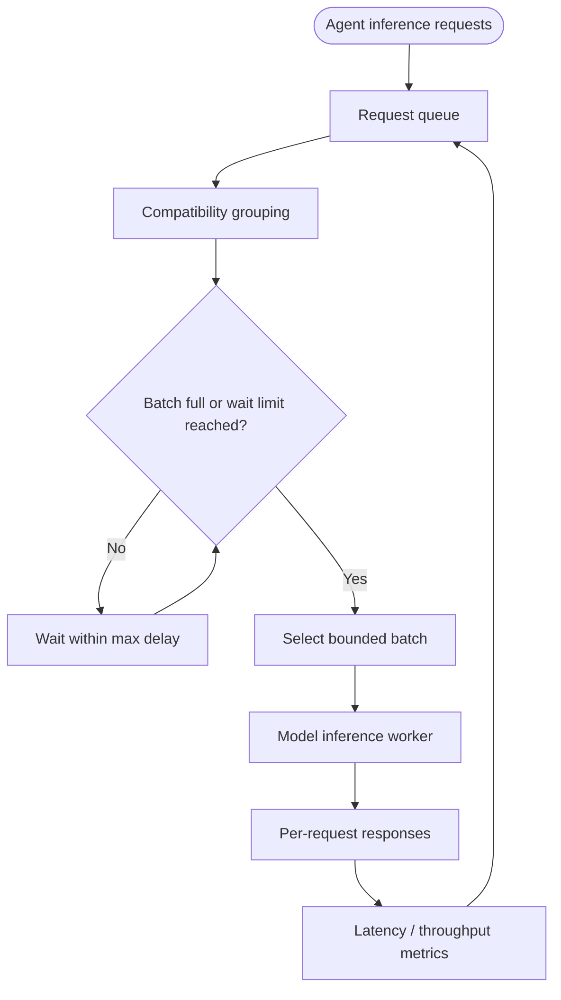

# NVIDIA: Latency-aware inference batch scheduler

> **Portfolio exercise, not a claim about proprietary internals.** This case study translates public engineering themes into an original, small reference implementation. It is not an exact reproduction of the company's production architecture.

## 1. Public source and analysis

**Primary source:** [NVIDIA public engineering source](https://developer.nvidia.com/blog/)

**Design problem:** An inference service must group compatible requests into bounded batches while balancing throughput, latency, and isolation across workloads.

**What the source supports:** Use the linked public source to understand the organization's documented principles. The architecture and implementation below are this repository's educational interpretation; do not attribute every component or design choice to the company.

**Requirements**
- Functional: complete the target workflow and return useful output.
- Reliability: handle invalid inputs and expected failures explicitly.
- Security: enforce trust boundaries in deterministic code.
- Observability: expose outcomes and useful counters.
- Cost/latency: bound concurrency, retries, context, or batch size as appropriate.

## 2. Mermaid architecture



## 3. Component breakdown

Group requests only when model, shape, and execution settings are compatible. Flush when the batch reaches its maximum size or the oldest request reaches its wait deadline. Keep a maximum queue age and isolate incompatible workloads.

| Component | Responsibility | Key invariant |
|---|---|---|
| Request boundary | Validate caller input and identity | Untrusted input is never policy |
| Coordinator | Select the next workflow step | Work remains bounded |
| Policy / control layer | Enforce permissions and budgets | Deny by default |
| Execution adapter | Call a narrowly scoped operation | Validate before side effects |
| State / evidence | Preserve progress and provenance | State is explicit and auditable |
| Evaluation / telemetry | Measure outcomes and failures | Metrics reflect user-visible results |

## 4. Python implementation

The runnable implementation is in [`agent.py`](agent.py). It uses only the Python standard library and intentionally substitutes deterministic functions for external models or services.

```python
from dataclasses import dataclass
from collections import defaultdict

@dataclass(frozen=True)
class Request:
    request_id: str
    model: str
    payload: str

def make_batches(requests, max_batch_size):
    if max_batch_size < 1:
        raise ValueError("max_batch_size must be positive")
    groups = defaultdict(list)
    for request in requests:
        groups[request.model].append(request)
    batches = []
    for model in sorted(groups):
        items = groups[model]
        for start in range(0, len(items), max_batch_size):
            batches.append((model, items[start:start + max_batch_size]))
    return batches
```

## 5. Unit tests

Tests are in [`test_agent.py`](test_agent.py).

```python
import unittest
from agent import Request, make_batches

class BatchTests(unittest.TestCase):
    def test_respects_batch_limit(self):
        requests = [Request(str(i), "m1", "x") for i in range(5)]
        batches = make_batches(requests, 2)
        self.assertEqual([len(batch) for _, batch in batches], [2, 2, 1])

    def test_never_mixes_models(self):
        requests = [Request("1", "m1", "x"), Request("2", "m2", "y")]
        batches = make_batches(requests, 8)
        self.assertEqual({model for model, _ in batches}, {"m1", "m2"})

    def test_invalid_batch_size(self):
        with self.assertRaises(ValueError):
            make_batches([], 0)

if __name__ == "__main__":
    unittest.main()
```

Run from this directory:

```bash
python -m unittest -v
```

## 6. Evaluation plan

Measure throughput, p50/p95/p99 queueing and end-to-end latency, batch fill ratio, GPU utilization, timeout rate, per-model fairness, and cost per successful request. Compare dynamic batching against no batching under mixed traffic.

Suggested experiment table:

| Experiment | Baseline | Variant | Metrics |
|---|---|---|---|
| Normal workload | Simple sequential/reference behavior | Proposed pattern | Success, latency, cost |
| Invalid or adversarial input | No control / test harness | Validation and policy enabled | Rejection correctness |
| Failure injection | No recovery | Bounded recovery | Recovery rate, duplicate effects |
| Load / scale | Low concurrency | Increased concurrency | Throughput, tail latency, resource use |

Record the dataset, environment, sample count, and measured results. Do not report hypothetical targets as experimental results.

## 7. Design trade-offs

Larger batches can improve accelerator utilization and throughput but increase queueing delay and memory pressure. Smaller batches reduce latency but may waste compute. Production scheduling needs deadlines, fairness, backpressure, memory-aware admission, cancellation, and workload isolation.

## 8. Limitations and production gaps

This example groups requests by model and maximum count only. It does not run GPU inference, model-specific shape compatibility, queue deadlines, or fairness scheduling. Benchmark with real traffic and hardware before selecting batch and wait limits.

## 9. Extension exercises

- Replace the deterministic stub with a typed adapter behind the same interface.
- Add structured traces with a correlation ID and per-step timing.
- Add configuration and tests for one additional failure mode.
- Create a small evaluation dataset and report measured results.
- Draw a revised Mermaid diagram after implementing your changes.

## 10. Design review questions

1. Which component is trusted, and why?
2. What happens when a dependency is slow or unavailable?
3. Which state must survive a process restart?
4. What is the system's most important correctness invariant?
5. Which metric would reveal a regression first?
6. What would you simplify if the system had a strict latency or cost budget?
