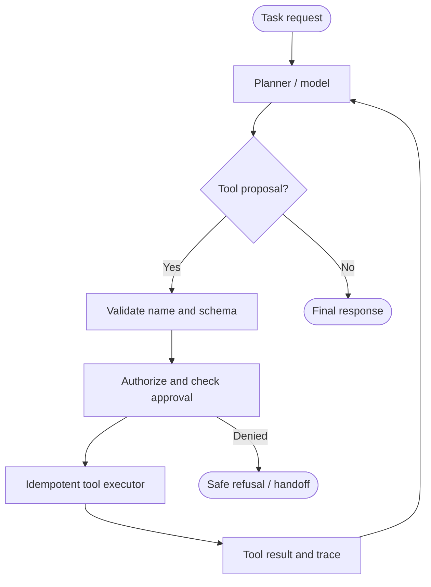

# OpenAI: Guarded tool-using workflow agent

> **Portfolio exercise, not a claim about proprietary internals.** This case study translates public engineering themes into an original, small reference implementation. It is not an exact reproduction of the company's production architecture.

## 1. Public source and analysis

**Primary source:** [OpenAI public engineering source](https://platform.openai.com/docs)

**Design problem:** A task assistant must plan a bounded workflow and call approved tools without treating model-generated actions as trusted instructions.

**What the source supports:** Use the linked public source to understand the organization's documented principles. The architecture and implementation below are this repository's educational interpretation; do not attribute every component or design choice to the company.

**Requirements**
- Functional: complete the target workflow and return useful output.
- Reliability: handle invalid inputs and expected failures explicitly.
- Security: enforce trust boundaries in deterministic code.
- Observability: expose outcomes and useful counters.
- Cost/latency: bound concurrency, retries, context, or batch size as appropriate.

## 2. Mermaid architecture



## 3. Component breakdown

Separate proposal from execution. The model may suggest a tool and arguments; deterministic code checks the allowlist, required fields, authorization, approval policy, and idempotency key before calling an adapter. Consequential actions pause for explicit approval.

| Component | Responsibility | Key invariant |
|---|---|---|
| Request boundary | Validate caller input and identity | Untrusted input is never policy |
| Coordinator | Select the next workflow step | Work remains bounded |
| Policy / control layer | Enforce permissions and budgets | Deny by default |
| Execution adapter | Call a narrowly scoped operation | Validate before side effects |
| State / evidence | Preserve progress and provenance | State is explicit and auditable |
| Evaluation / telemetry | Measure outcomes and failures | Metrics reflect user-visible results |

## 4. Python implementation

The runnable implementation is in [`agent.py`](agent.py). It uses only the Python standard library and intentionally substitutes deterministic functions for external models or services.

```python
from dataclasses import dataclass

@dataclass(frozen=True)
class ToolCall:
    name: str
    arguments: dict
    idempotency_key: str

class ToolRuntime:
    def __init__(self, tools, required_fields, approved=()):
        self.tools = tools
        self.required_fields = required_fields
        self.approved = set(approved)
        self.completed = {}

    def execute(self, call: ToolCall, actor: str):
        if call.name not in self.tools:
            raise PermissionError("Tool is not allowlisted")
        missing = set(self.required_fields[call.name]) - set(call.arguments)
        if missing:
            raise ValueError(f"Missing fields: {sorted(missing)}")
        if call.name.startswith("write_") and call.idempotency_key not in self.approved:
            raise PermissionError("Human approval required")
        key = (actor, call.idempotency_key)
        if key in self.completed:
            return self.completed[key]
        result = self.tools[call.name](**call.arguments)
        self.completed[key] = result
        return result
```

## 5. Unit tests

Tests are in [`test_agent.py`](test_agent.py).

```python
import unittest
from agent import ToolCall, ToolRuntime

class ToolRuntimeTests(unittest.TestCase):
    def setUp(self):
        self.runtime = ToolRuntime(
            {"lookup": lambda item: f"found:{item}", "write_note": lambda text: f"saved:{text}"},
            {"lookup": {"item"}, "write_note": {"text"}},
        )

    def test_allowlisted_tool_runs(self):
        call = ToolCall("lookup", {"item": "manual"}, "k1")
        self.assertEqual(self.runtime.execute(call, "alice"), "found:manual")

    def test_unknown_tool_rejected(self):
        with self.assertRaises(PermissionError):
            self.runtime.execute(ToolCall("shell", {}, "k2"), "alice")

    def test_write_requires_approval(self):
        call = ToolCall("write_note", {"text": "hello"}, "k3")
        with self.assertRaises(PermissionError):
            self.runtime.execute(call, "alice")

    def test_idempotent_replay(self):
        call = ToolCall("lookup", {"item": "manual"}, "same")
        first = self.runtime.execute(call, "alice")
        second = self.runtime.execute(call, "alice")
        self.assertEqual(first, second)

if __name__ == "__main__":
    unittest.main()
```

Run from this directory:

```bash
python -m unittest -v
```

## 6. Evaluation plan

Measure task success, valid-tool-call rate, schema rejection rate, unauthorized-action rejection, approval completion, duplicate side-effect prevention, end-to-end latency, and cost per completed task. Test adversarial tool proposals and malformed arguments.

Suggested experiment table:

| Experiment | Baseline | Variant | Metrics |
|---|---|---|---|
| Normal workload | Simple sequential/reference behavior | Proposed pattern | Success, latency, cost |
| Invalid or adversarial input | No control / test harness | Validation and policy enabled | Rejection correctness |
| Failure injection | No recovery | Bounded recovery | Recovery rate, duplicate effects |
| Load / scale | Low concurrency | Increased concurrency | Throughput, tail latency, resource use |

Record the dataset, environment, sample count, and measured results. Do not report hypothetical targets as experimental results.

## 7. Design trade-offs

A strict allowlist and approval gate improve safety but add friction and latency. Idempotency prevents duplicate effects only when keys are stable and the backing operation honors the same semantics. A deterministic workflow is preferable when the task graph is known; agent planning is useful when steps depend on observations.

## 8. Limitations and production gaps

This local demo uses in-memory idempotency and toy functions. Production systems need durable idempotency storage, authenticated identity, typed schemas, audit logs, timeouts, rate limits, and real approval workflows.

## 9. Extension exercises

- Replace the deterministic stub with a typed adapter behind the same interface.
- Add structured traces with a correlation ID and per-step timing.
- Add configuration and tests for one additional failure mode.
- Create a small evaluation dataset and report measured results.
- Draw a revised Mermaid diagram after implementing your changes.

## 10. Design review questions

1. Which component is trusted, and why?
2. What happens when a dependency is slow or unavailable?
3. Which state must survive a process restart?
4. What is the system's most important correctness invariant?
5. Which metric would reveal a regression first?
6. What would you simplify if the system had a strict latency or cost budget?
